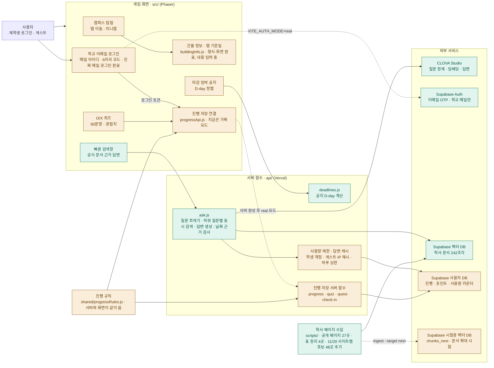

# 🧩 HUFS Quest 기능 구조도

> 기능이 어디에 있고 무엇과 연결되는지 한눈에 보는 문서입니다. **기능 상태가 바뀌면 이 파일도 같은 PR에서 고칩니다.**
> 마지막 수정: 2026-11-19 · 일정과 담당자는 [ROADMAP.md](ROADMAP.md) · 만들지 않는 것은 [PRD.md](PRD.md)

## 구조도



| 색 | 상태 |
| --- | --- |
| 🟩 초록 | 동작 중 |
| 🟨 노랑 | 일부 구현 (예: 공지는 예시 데이터, 진행 저장은 서버 없이 가짜 모드) |
| 🟥 빨강 점선 | 본선에서 만들 것 |

화면 전체에 걸친 기능인 **한/영 다국어**와 **외부인(게스트) 모드**는 이미 동작 중이라 상자로 따로 그리지 않았습니다.

## 구조도 고치는 법

상자 색은 맨 아래 `class` 세 줄이 정합니다. 기능이 완성되면 그 이름을 다른 줄로 옮기면 됩니다.

```
class search,ask,deadlines,clova,vector,collect,supaAuth done      ← 동작 중
class explore,quiz,notice,progress,rules,userDb,login,limiter,mapInfo,newApi,vectorNext partial    ← 일부 구현
(만들 것 todo: 11/19 기준 없음. 새로 만들 기능이 생기면 `class 이름 todo` 줄을 다시 추가)
```

- 예: 건물 정보 분리가 완성되면 `mapInfo`를 `todo` 줄에서 지우고 `done` 줄에 넣습니다.
- 건물 내부 진입과 행사 마커는 PRD '하지 않을 것'에 따라 11/18 구조도에서 뺐습니다.
- 새 기능을 추가하면 알맞은 `subgraph` 안에 `이름["제목<br/>한 줄 설명"]` 한 줄을 넣고, 연결선(`A --> B`)과 `class` 줄도 추가합니다.
- 점선(`-.->`)은 아직 실제로 오가지 않는 연결입니다. 진행 저장은 서버가 생기면 `VITE_PROGRESS_MODE=real`로, 로그인은 Supabase 메일 설정 후 `VITE_AUTH_MODE=real`로 전환해 실선이 됩니다. 두 값은 따로 고릅니다([AUTH_SETUP.md](AUTH_SETUP.md) 0장).
- GitHub에서 파일을 열면 바로 그림으로 보입니다. 그림이 깨지면 따옴표나 괄호가 빠졌는지 확인하세요.

## 상자별 파일과 담당

| 상자 | 주요 파일 | 담당 |
| --- | --- | --- |
| 캠퍼스 탐험 | `src/scenes/CampusScene.js`, `src/scenes/MapScene.js`(전체 지도, 1타일 5px), `src/data/campus.js`(**88×90 · 북쪽 위 · 1타일 4m**, 바닥 격자 `GROUND` + 건물 `parts` · `door` · HUFS MAP 공식 좌표, 기준은 [`docs/GRAPHICS.md`](GRAPHICS.md)), `src/gfx/textures.js`. 테스트 `tests/campusLayout.test.js`(건물 겹침 · 입구 · NPC · 퀴즈 상자 자리 · SPAWN에서 BFS 도달 · 공식 좌표 · `buildingInfo.js` id 일치) | 이종헌 |
| 빠른 검색창 | `src/ui/searchBar.js` → `src/data/askApi.js` → `api/ask.js` (11/20~ `shared/academicDate.js`: 한국 시간 오늘 날짜 · 현재 학기를 지시문에 붙이고, 답변의 날짜(연-월-일 · 월-일)나 연도(YYYY학년도 · YYYY년)가 근거 조각에 없으면 "찾지 못함"으로 바꿈. 테스트 `tests/academicDate.test.js`. 11/20~ `api/_lib/decompose.js`: 질문을 하위 질문 최대 2개로 쪼개(`parseQueries`) 하위 질문마다 동시에 벡터 검색하고 `mergeDocs`로 합침, RPC는 `CHUNKS_RPC`(match_chunks · match_chunks_next만 허용). 테스트 `tests/decompose.test.js`. `api/_lib/answerFormat.js`: 답변의 줄 맨 앞 번호 목록을 지우고, 넘긴 자료 수를 넘는 인용 번호를 지움. 11/22~ 출력 상한(400)에 걸려 끊긴 답은 끝난 문장까지만(`trimTruncated`). 테스트 `tests/answerFormat.test.js`) | 신중혁 |
| O/X 퀴즈 | `src/scenes/QuizScene.js`, `src/quizBoxes.js`(상자 자리는 `campus.js` `quizBoxTiles`), `src/quizProgress.js`, `src/data/quiz.js` | 이종헌(배치) · 신중혁(문항) |
| 마감 임박 공지 | `src/ui/deadlineOverlay.js` → `api/deadlines.js` ← `shared/deadlines.js` | 이종헌(화면) · 임현규(데이터) · 신중혁(추출) |
| 건물 정보 · 맵 기준일 | `src/data/buildingInfo.js`(건물 ID 기준: 이름·용도·층별 사무실·출처·확인일·상태, `MAP_BASE_DATE` · `OFFICIAL_MAP_URL` · `REPORT_FORM_URL` · `REPORT_FORM_PLACE_ENTRY` · `reportFormUrl()`) → `src/data/campus.js`(ID·위치만, 이름은 여기서 붙여 내보냄. `onMap: false`인 장소는 맵에 그리지 않음) · `src/data/npcs.js`(대사 없는 건물은 확인된 용도 표시) · `src/scenes/MapScene.js` `drawMapBasis`(기준일 · 공식 지도 · 신고 버튼, 폼 주소가 비면 신고 버튼 숨김) · `scripts/report-form/`(구글 폼 생성 Apps Script, 건물 이름 목록은 `buildPlaceList.mjs`가 `buildingInfo.js`에서 만듦) · `tests/reportFormUrl.test.js`. **형식·화면 완료, 신고 폼 연결 완료, 근처 건물 미리 채움**(폼에는 건물 이름 하나만 보냄). 용도·층별 사무실 내용은 아직 | 이종헌(형식·화면) · 임현규(내용) |
| 사용량 제한 · 답변 캐시 | `api/_lib/usageLimit.js` (한도 상수 분당 10 · 학생 하루 50 · 게스트 IP 하루 150 · 전체 하루 500. **11/19~ 로그인 학생은 계정 기준**: 요청의 로그인 토큰을 Supabase `/auth/v1/user`로 확인해 `@hufs.ac.kr`이면 "user:<id>" 해시로, 아니면(게스트 · 토큰 오류 · 확인 실패) IP 해시로 셈. 해시 = SHA-256(`ASK_IP_SALT` + 한국 날짜 + 계정 또는 IP), 화면 `src/data/askApi.js`가 로그인 토큰을 붙여 보냄, 1차 메모리 제한 → 2차 `ask_hit`, Supabase 실패 시 메모리 제한으로 대체, eval 토큰은 IP 한도만 건너뜀) ← `api/ask.js`가 첫 AI 호출 전에 호출(429 `{ error, reason, retryAfter }`, 200자 초과 400). DB는 `supabase/003_usage_limits.sql`(11/18 실행). 화면 안내 `src/data/askApi.js`(`busy` · `limit`), 테스트 `tests/usageLimit.test.js`. **사용량 제한은 Preview 확인 전, 답변 캐시는 아직** | 임현규 · 신중혁 |
| 진행 저장 연결 | `src/data/progressApi.js` (화면은 이 파일로만 진행 상태를 주고받음), `src/data/progressMock.js` (가짜 서버), `src/state.js` `applyProgress`, `src/quizProgress.js`, 테스트 `tests/progressMock.test.js` | 이종헌 (`state.js`·`quizProgress.js`는 임현규와 공동) |
| 학교 이메일 로그인 | `src/ui/loginOverlay.js` (로그인 창, 1단계에 개인정보 안내 4줄 + 동의 체크박스 · 문구는 `state.js` `loginPrivacy*`) → `src/data/auth.js` (화면은 이 파일로만 로그인, `VITE_AUTH_MODE`로 가짜/진짜 전환) ← `src/data/authRules.js` (메일 아이디 규칙 · 도메인 목록 · 코드 6자리 · 재발송 60초 · 만료 10분), `src/data/authMock.js` (가짜 인증). 타이틀 연결 `src/scenes/TitleScene.js`, 로그아웃 `HudScene.js` · `CampusScene.js`, 테스트 `tests/auth.test.js` · `tests/progressMode.test.js`, 설정 순서 `docs/AUTH_SETUP.md`. **진짜 메일 로그인 완료(11/19, 임현규)** | 이종헌 (서버 설정 · Auth Hook: 임현규) |
| 진행 규칙 | `shared/progressRules.js` (레벨 계산, 보상 값, 하루 상한, 보상 퀘스트 목록, 한국 시간 날짜) | 임현규 |
| 진행 저장 서버 함수 | `api/progress.js`, `api/quiz-answer.js`, `api/quest-complete.js`, `api/check-in.js`, `api/_lib/progressServer.js`, 테스트 `tests/progressApiServer.test.js` (**구현 완료, 11/19 확인 완료**) | 임현규 |
| Supabase 사용자 DB | `supabase/001_progress_schema.sql` (진행 저장 테이블 4개 · RLS · 보상 함수 3개), `supabase/002_revoke_match_chunks.sql` (검색 함수 브라우저 호출 차단), `supabase/003_usage_limits.sql` (사용량 카운터, 11/18 실행), `supabase/005_chunks_next.sql` (시험용 벡터 DB `chunks_next` · 검색 함수 `match_chunks_next`, service_role만 실행, 11/20 실행 · 이종헌. 맨 아래에 실서비스 `match_chunks` 원본 정의 기록) | 임현규 |
| CLOVA Studio · Supabase 벡터 DB | `api/ask.js`, `scripts/ingest.mjs` (11/20~ `--target next`: 실서비스 `chunks` 대신 시험용 `chunks_next`에 저장 · 옛 조각 삭제 · 개수 확인, 첫 줄에 대상 테이블 출력, `--dry-run`과 함께 사용 가능. `api/ask.js`는 계속 `chunks`만 검색. 11/21~ `scripts/lib/retry.mjs`: 임베딩 · 저장 실패 시 2 · 5 · 10초 뒤 최대 3번 다시 시도, 그래도 실패하면 멈춘 조각 번호 · id를 출력하고 옛 조각 삭제 없이 종료 코드 1, 진행 표시는 50조각마다. 테스트 `scripts/lib/retry.test.mjs`) | 신중혁 |
| 서버 함수 실행 지역 | 저장소 루트 `vercel.json`의 `"regions": ["icn1"]`(서울). Supabase(ap-northeast-2 서울) · CLOVA Studio가 한국에 있고 개인정보 처리 위치도 한국으로 두기 위함. Vercel 문서상 `vercel.json` 값이 대시보드 Function Regions 설정보다 우선 | 이종헌 |
| 범위 밖 기능 숨김 | `src/data/features.js`의 `SHOW_OUT_OF_SCOPE`(지금 `false`). false면 HUD "수강신청 추천 서비스" 버튼(`HudScene.renderPlannerButton`)을 만들지 않고, 퀘스트 목록(`state.js` `QUEST_LIST`)에서 `outOfScope` 퀘스트(`mockReg`)를 빼고, `CampusScene.openPlanner` · `openMockReg` 진입을 막음. 숨김 대상 파일(`public/planner/`, `plannerOverlay.js`, `MockRegScene.js`, `teammate/`)과 `main.js` 장면 등록은 그대로 | 이종헌 |
| 학사 페이지 수집 | `scripts/urls.txt`, `scripts/collect.mjs`, `scripts/lib/hufsPage.mjs` (11/20~ 사람 이름 표시(담당자 ○○○ · ○○○ 선생님 · 주무관 · 교수)가 있는 줄은 이름과 그 구간의 메일 · 직통번호만 "(개인 연락처 생략)"으로 가림(줄 · 대표번호 · 부서 메일은 남김). 이름 표시 없는 개인 메일은 `PERSONAL_MAIL_IDS` 목록으로 가림, 각주 기호(`*`) 정리, 본문 40자 미만 조각 제거(부서 연락처 조각은 예외), 캠퍼스 표시 `[서울]` · `[글로벌]`. 테스트 `scripts/lib/hufsPage.test.mjs`), collect는 `[글로벌]` 표시 조각을 저장하지 않고(서울캠퍼스 서비스, 11/20 eval 2025학번 졸업학점 오답 원인), 본문이 같은 조각을 해시로 하나만 남기고 "글로벌 전용 조각 제외 n개(표 정리 포함), 중복 제거 n개, 개인 연락처 가림 n줄"과 가린 메일 아이디를 출력. 학사일정 `scripts/lib/calendarPage.mjs`는 조각마다 적용 학년도 범위 문장 · 겨울방학 조각에 다음 학년도 개강일 없음 문장 | 신중혁 |
| 표 정리 조각 | `scripts/tablePages.mjs`, `scripts/lib/tableGrid.mjs`, `scripts/lib/tableSentences.mjs`, `scripts/lib/tableCheck.mjs` → `data/table-check.md` (11/20~ 표 제목에 글로벌캠퍼스만 있는 문장은 `excludeGlobalOnlyTables`로 빼고, 검수표에 "제외"로 표시) | 이종헌 (검색창 개선 1~4단계) |

게임 상태(경험치·포인트)는 `src/state.js`에 있고, 서버 저장과 연결하는 부분은 이종헌·임현규 공동 담당입니다. 재학생의 레벨·경험치·포인트·완료 퀘스트는 서버 응답으로만 바뀌고(`applyProgress`), 게스트는 서버를 부르지 않고 메모리에서만 동작합니다.

## 주요 흐름

**빠른 검색창 질문 하나가 답이 되기까지**
1. `HCX-DASH-002`가 구어체 질문을 공식 학사 용어 검색어로 정리하고 `{"queries": [...]}` JSON으로 돌려줍니다. 주제가 하나면 1개, 서로 다른 제도 · 일정을 함께 물을 때만 2개(예: "이중전공과 부전공은 각각 몇 학점이야?")입니다. `api/_lib/decompose.js`의 `parseQueries`가 읽고(최대 2개 · 각 80자), JSON이 아니면 예전 방식처럼 한 줄 검색어(`fallbackQuery`, 1~80자 · `{ }` 없음)로, 그것도 아니면 원래 질문 하나로 검색합니다(로그 `rewriteFormat`: json · line · none).
2. 하위 질문마다 동시에 CLOVA 임베딩 v2로 벡터화해 Supabase RPC(`CHUNKS_RPC`, 기본 `match_chunks`)에서 하위 질문당 6개까지 찾고, 1등과의 유사도 차이 필터는 하위 질문별로 겁니다. 한 하위 질문만 실패하면 그 질문만 `shared/kb.js` 키워드 검색으로 대신합니다.
3. `mergeDocs`가 중복 조각을 빼고 하위 질문마다 3개를 보장해 최대 6개(하위 질문 1개면 4개)로 합칩니다. 하위 질문이 둘 이상이면 그 3개를 고를 때 같은 페이지 조각은 2개까지만 먼저 넣습니다(11/21~, 한 페이지의 비슷한 조각이 몫을 다 차지해 필요한 근거가 잘리는 것 방지). 로그 `subQueryIds`에 하위 질문별로 최종 근거에 들어간 조각 id가 남습니다. 근거가 없으면 전체를 키워드 검색으로 다시 찾고, 그래도 없으면 AI를 부르지 않고 "찾지 못했다"고 답합니다.
4. 근거와 하위 질문 목록을 넘겨 `HCX-005`가 답하고(출력 상한 `ANSWER_MAX_TOKENS` 400, 11/22~), 상한에 걸려 끊긴 답은 마지막으로 끝난 문장까지만 남기며 끝난 문장이 없으면 원문 보여 주기로 바꿉니다(`trimTruncated`, 로그 `truncated`). 실제 인용된 출처 링크만 보여 줍니다. 답변의 줄 맨 앞 번호 목록은 지우고, 넘긴 자료 수를 넘는 인용 번호([4] 등)도 지웁니다(`api/_lib/answerFormat.js`, 로그 `droppedCitations`). 하위 질문이 둘이면 각각 따로 답하고 근거가 없는 쪽만 "찾지 못했어요"라고 합니다. 지시문에는 한국 시간 오늘 날짜 · 현재 학기가 붙습니다. 로그에는 하위 질문 개수 · 하위 질문별 근거 수 · RPC 이름만 남깁니다.
5. 답변에 근거 조각에 없는 날짜(연-월-일 · 월-일)나 연도(YYYY학년도 · YYYY년)가 있으면 "찾지 못했다"로 바꾸고(로그 `mode: guard`), 근거에 없는 숫자가 있으면 근거 원문을 대신 보여 줍니다(`mode: evidence`). AI 호출 실패 · 숫자 검사 실패로 원문을 보여 줄 때 하위 질문이 둘이면 각 하위 질문의 1등 근거를 하나씩(`evidenceDocs`), 하나면 앞의 2개를 보여 줍니다.

**재학생 퀴즈 답 하나가 저장되기까지**
1. `QuizScene`이 고른 답(O/X)을 `quizProgress.recordAnswer` → `progressApi.answerQuiz`로 보냅니다. 화면은 경험치를 계산하지 않습니다.
2. 서버(지금은 `progressMock.js` 가짜 서버)가 `src/data/quiz.js`의 정답과 비교하고, 중복 지급 · 한국 시간 하루 상한(50)을 확인해 `ok` · `wrong` · `already` · `cap`과 최신 `progress`를 돌려줍니다.
3. 화면은 `applyProgress`로 `session`을 덮어쓰고 HUD를 다시 그립니다. 저장에 실패하면 경험치를 주지 않고 "저장하지 못했어요"를 보여 줍니다.
4. 가짜 모드는 새로고침하면 초기화됩니다. 주소에 `?mock=cap` · `already` · `error` · `slow`를 붙여 상황을 재현할 수 있습니다.

**재학생 로그인부터 캠퍼스 입장까지**
1. 타이틀 "재학생 로그인" → `loginOverlay`에서 학교 메일 아이디(영문 대 · 소문자와 숫자, 최대 64자, 보낼 때 소문자로 변환) + 도메인 목록(`@hufs.ac.kr`)으로 이메일을 조립합니다. 아이디 · 이메일은 저장하거나 로그로 남기지 않습니다.
2. `auth.sendCode`가 6자리 코드를 보냅니다(진짜: Supabase `signInWithOtp`, 가짜: 화면 왼쪽 아래에 개발용 코드). 같은 주소는 60초 뒤에만 다시 받을 수 있고, 코드는 10분 뒤 만료됩니다.
3. `auth.verifyCode`가 통과하면 `getProgress` → `checkIn` → 캠퍼스 입장. 로그인은 브라우저에 남아 새로고침해도 유지되고, HUD "로그아웃"으로 지웁니다.
4. 진행 API 요청에는 `progressApi`가 로그인 토큰(`Authorization: Bearer`)을 붙입니다. 학교 메일이 아닌 가입은 Supabase Auth Hook과 진행 API의 403이 서버에서 막습니다([AUTH_SETUP.md](AUTH_SETUP.md) 4장).

**학사 문서가 벡터 DB에 들어가기까지**
1. `scripts/urls.txt`의 공개 페이지를 `npm run collect`가 1.5초 간격으로 받아 `data/chunks.json`에 조각으로 저장합니다.
2. `scripts/tablePages.mjs`에 있는 페이지(졸업이수학점·전과·수료·학석사연계과정)는 기존 조각에 더해 **표 정리 조각**(`<페이지>-t01` …)도 만듭니다. 표의 rowspan/colspan을 풀어 행마다 캠퍼스·학번·단과대학·이수 유형을 붙인 한 문장으로 바꾸므로, 숫자가 다른 표의 조건과 섞이지 않습니다. 숫자는 원문 칸에서만 가져오고, 괄호 값처럼 뜻이 애매한 행은 문장을 만들지 않고 보류합니다.
3. collect가 원문 행과 생성 문장을 나란히 보여 주는 `data/table-check.md`를 만듭니다. **사람이 숫자를 검수한 뒤에만** ingest를 실행합니다. (표 문장 규칙 테스트: `npm test`)
4. `npm run ingest`가 조각마다 CLOVA 임베딩(1024차원)을 만들어 Supabase `chunks` 테이블에 저장하고, 이번에 없는 옛 조각은 지웁니다. **실제 서비스 DB가 바뀌므로 실행 전에 단톡에 알리고, 실행한 사실과 조각 수 변화를 PR에 적습니다.** 문서를 크게 늘릴 때는 먼저 `npm run ingest -- --target next`로 시험용 `chunks_next`에 넣어 봅니다(실서비스 검색에는 쓰이지 않음).

## 변경 기록

| 날짜 | 변경 내용 | 작성 |
| --- | --- | --- |
| 2026-11-17 | 구조도 첫 작성 | 이종헌 |
| 2026-11-17 | 표 정리 조각 추가(벡터 DB 216 → 242조각), 수집 흐름에 검수 단계 추가 | 이종헌 |
| 2026-11-17 | 진행 저장 연결(`progressApi.js`, 가짜 모드)과 진행 규칙(`shared/progressRules.js`) 상자 추가, 일부 구현으로 표시 | 이종헌 |
| 2026-11-18 | Supabase 사용자 DB를 일부 구현으로 표시(진행 저장 스키마 실행, `supabase/`에 SQL 기록) | 이종헌 |
| 2026-11-18 | 학교 이메일 로그인 상자(일부 구현: 가짜 모드 완료, 진짜 메일 미시험)와 Supabase Auth 상자 추가, 파일 표에 로그인 파일 추가 | 이종헌 |
| 2026-11-18 | 사전교육 피드백 반영: 건물 내부 진입 · 행사 마커 상자 제외, 건물 정보 · 맵 기준일과 사용량 제한 · 답변 캐시 상자 추가 | 이종헌 |
| 2026-11-18 | 로그인 아이디를 학번 9자리에서 학교 메일 아이디(영문 대 · 소문자와 숫자, 최대 64자)로 고침 | 이종헌 |
| 2026-11-18 | 파일 표에 `supabase/003_usage_limits.sql`(검색창 공용 사용량 카운터) 추가, 같은 날 대시보드 실행. 사용량 제한 상자는 `api/ask.js` 연결 전이라 "만들 것" 그대로 | 이종헌 |
| 2026-11-19 | `api/_lib/usageLimit.js`로 `api/ask.js`와 `ask_hit` 연결, 사용량 제한 상자를 "일부 구현"으로(Preview 확인 · 답변 캐시 남음) | 이종헌 |
| 2026-11-19 | 서버 함수 실행 지역을 iad1(미국)에서 icn1(서울)로(`vercel.json`), 파일 표에 추가 | 이종헌 |
| 2026-11-19 | 범위 밖 기능(수강신청 추천 버튼 · 모의 수강신청 퀘스트)을 `src/data/features.js` 설정 하나로 숨김, 파일 표에 추가 | 이종헌 |
| 2026-11-19 | 로그인 창 1단계에 개인정보 안내 4줄과 동의 체크박스 추가(파일 표 로그인 줄) | 이종헌 |
| 2026-11-19 | 신고 폼 연결 완료, 근처 건물 미리 채움(파일 표 건물 정보 줄에 `scripts/report-form/` · 테스트 추가) | 이종헌 |
| 2026-11-19 | 진짜 메일 로그인 적용·확인 완료(supaAuth 완료로 이동, 004_auth_hook_hufs_only.sql 정리, 설정 기록 추가) | 임현규 |
| 2026-11-19 | 진행 저장 서버 함수 4종(progress, quiz-answer, quest-complete, check-in) 및 공통 모듈·단위 테스트 구현(newApi 일부 구현으로 이동, todo 줄 비움) | 임현규 |
| 2026-11-19 | 검색창 사용량 제한을 로그인 학생은 계정 기준, 게스트는 IP 기준으로 변경(같은 와이파이 사용자끼리 한도를 나눠 쓰던 버그, 임현규 제보). 사용량 제한 상자 · 파일 표 갱신 | 이종헌 |
| 2026-11-20 | 검색창 날짜 근거 검사(`shared/academicDate.js`, 오늘 날짜 · 현재 학기 전달, 근거에 없는 날짜 차단): ask.js 상자 · 파일 표 · 주요 흐름 갱신 | 이종헌 |
| 2026-11-20 | 검색창 복합 질문 나눠 찾기(`api/_lib/decompose.js`, 하위 질문 최대 2개 동시 검색 · 합치기, `CHUNKS_RPC`): ask.js 상자 · 파일 표 · 주요 흐름 갱신. Preview eval 확인 전 | 이종헌 |
| 2026-11-20 | 문서 확대 준비: 시험용 벡터 DB `chunks_next` 상자 · `ingest --target next` 점선 추가, 수집 정리 규칙(개인 연락처 줄 · 각주 · 짧은 조각 · 캠퍼스 표시 · 중복 제거)과 학사일정 범위 문장을 파일 표에 반영 | 이종헌 |
| 2026-11-20 | `supabase/005_chunks_next.sql`(11/20 대시보드 실행분 기록)을 파일 표에 추가 | 이종헌 |
| 2026-11-20 | 수집 표에 `[글로벌]` 조각 저장 제외 · 지운 메일 아이디 출력 반영 | 이종헌 |
| 2026-11-20 | 개인 연락처를 줄 삭제 대신 이름 · 메일 · 직통번호 가림으로 변경, 표 정리 조각의 글로벌캠퍼스 전용 문장 제외 | 이종헌 |
| 2026-11-20 | 수집의 40자 미만 조각 버리기에 예외 추가(숫자 · 학점 · 기간 · 인원 같은 규칙 조각은 남김, 468 → 485조각) | 이종헌 |
| 2026-11-21 | ingest 재시도(`scripts/lib/retry.mjs`)와 50조각마다 진행 표시: CLOVA · Supabase 상자 파일 표 갱신 | 이종헌 |
| 2026-11-21 | 질문 쪼개기 합치기 규칙: 하위 질문이 둘 이상이면 질문별 몫에 같은 페이지 조각 2개까지(조기졸업 · 졸업 평점 오답 수정), 로그 `subQueryIds` 추가 | 이종헌 |
| 2026-11-22 | 검색창 답변 출력 상한 1000 → 400(11/22 eval 출력 토큰 최대 202), 끊긴 답 정리(`api/_lib/answerFormat.js` `trimTruncated`) · 로그 `truncated`: 주요 흐름 4번 갱신 | 이종헌 |
