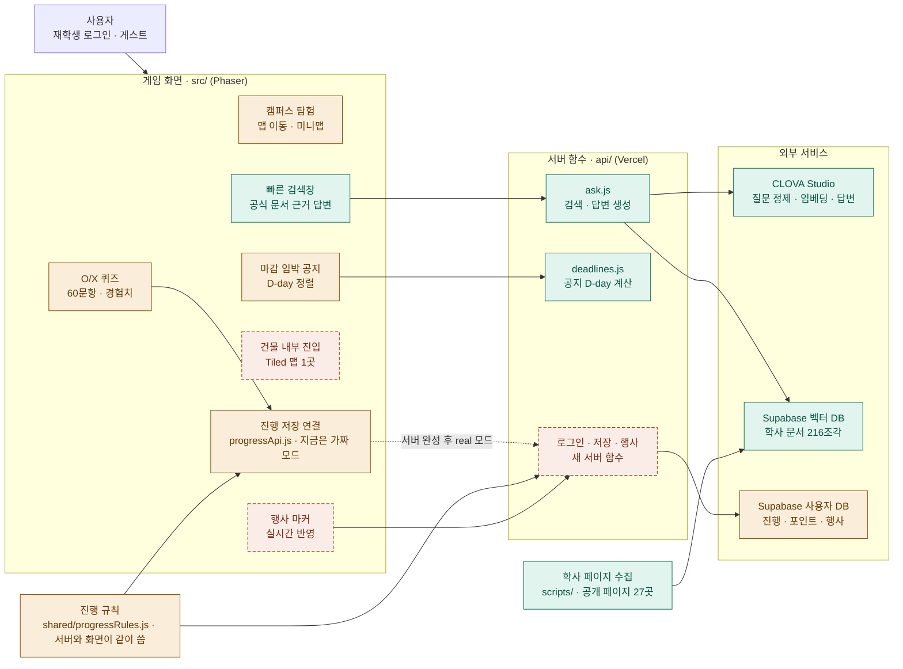

# 🧩 HUFS Quest 기능 구조도

> 기능이 어디에 있고 무엇과 연결되는지 한눈에 보는 문서입니다. **기능 상태가 바뀌면 이 파일도 같은 PR에서 고칩니다.**
> 마지막 수정: 2026-11-18 · 일정과 담당자는 [ROADMAP.md](ROADMAP.md)

## 구조도



| 색 | 상태 |
| --- | --- |
| 🟩 초록 | 동작 중 |
| 🟨 노랑 | 일부 구현 (예: 공지는 예시 데이터, 진행 저장은 서버 없이 가짜 모드) |
| 🟥 빨강 점선 | 본선에서 만들 것 |

화면 전체에 걸친 기능인 **한/영 다국어**와 **외부인(게스트) 모드**는 이미 동작 중이라 상자로 따로 그리지 않았습니다.

## 구조도 고치는 법

상자 색은 맨 아래 `class` 세 줄이 정합니다. 기능이 완성되면 그 이름을 다른 줄로 옮기면 됩니다.

```
class search,ask,deadlines,clova,vector,collect done      ← 동작 중
class explore,quiz,notice,progress,rules,userDb partial    ← 일부 구현
class interior,eventMarker,newApi todo                     ← 만들 것
```

- 예: 행사 마커가 완성되면 `eventMarker`를 `todo` 줄에서 지우고 `done` 줄에 넣습니다.
- 새 기능을 추가하면 알맞은 `subgraph` 안에 `이름["제목<br/>한 줄 설명"]` 한 줄을 넣고, 연결선(`A --> B`)과 `class` 줄도 추가합니다.
- 점선(`-.->`)은 아직 실제로 오가지 않는 연결입니다. 진행 저장은 서버가 생기면 `VITE_PROGRESS_MODE=real`로 전환해 실선이 됩니다.
- GitHub에서 파일을 열면 바로 그림으로 보입니다. 그림이 깨지면 따옴표나 괄호가 빠졌는지 확인하세요.

## 상자별 파일과 담당

| 상자 | 주요 파일 | 담당 |
| --- | --- | --- |
| 캠퍼스 탐험 | `src/scenes/CampusScene.js`, `src/scenes/MapScene.js`, `src/data/campus.js`, `src/gfx/textures.js` | 이종헌 |
| 빠른 검색창 | `src/ui/searchBar.js` → `src/data/askApi.js` → `api/ask.js` | 신중혁 |
| O/X 퀴즈 | `src/scenes/QuizScene.js`, `src/quizBoxes.js`, `src/quizProgress.js`, `src/data/quiz.js` | 이종헌(배치) · 신중혁(문항) |
| 마감 임박 공지 | `src/ui/deadlineOverlay.js` → `api/deadlines.js` ← `shared/deadlines.js` | 이종헌(화면) · 임현규(데이터) · 신중혁(추출) |
| 건물 내부 진입 | 새로 만듦. `campus-map/js/game.js`, `campus-map/js/tiles.js` 참고 | 이종헌 |
| 행사 마커 | 새로 만듦. `campus-map/js/state.js`의 행사 로직 참고 | 이종헌(화면) · 임현규(데이터) |
| 진행 저장 연결 | `src/data/progressApi.js` (화면은 이 파일로만 진행 상태를 주고받음), `src/data/progressMock.js` (가짜 서버), `src/state.js` `applyProgress`, `src/quizProgress.js`, 테스트 `tests/progressMock.test.js` | 이종헌 (`state.js`·`quizProgress.js`는 임현규와 공동) |
| 진행 규칙 | `shared/progressRules.js` (레벨 계산, 보상 값, 하루 상한, 보상 퀘스트 목록, 한국 시간 날짜) | 임현규 |
| 로그인 · 저장 · 행사 서버 함수 | 새 `api/*` (형식은 `docs/PROGRESS_API.md`) | 임현규 |
| Supabase 사용자 DB | `supabase/001_progress_schema.sql` (진행 저장 테이블 4개 · RLS · 보상 함수 3개), `supabase/002_revoke_match_chunks.sql` (검색 함수 브라우저 호출 차단). 행사 테이블은 아직 없음 | 임현규 |
| CLOVA Studio · Supabase 벡터 DB | `api/ask.js`, `scripts/ingest.mjs` | 신중혁 |
| 학사 페이지 수집 | `scripts/urls.txt`, `scripts/collect.mjs`, `scripts/lib/hufsPage.mjs` | 신중혁 |

게임 상태(경험치·포인트)는 `src/state.js`에 있고, 서버 저장과 연결하는 부분은 이종헌·임현규 공동 담당입니다. 재학생의 레벨·경험치·포인트·완료 퀘스트는 서버 응답으로만 바뀌고(`applyProgress`), 게스트는 서버를 부르지 않고 메모리에서만 동작합니다.

## 주요 흐름

**빠른 검색창 질문 하나가 답이 되기까지**
1. `HCX-DASH-002`가 구어체 질문을 공식 학사 용어 검색어로 정리합니다.
2. CLOVA 임베딩 v2로 벡터화해 Supabase에서 비슷한 조각을 찾습니다. 실패하면 `shared/kb.js` 키워드 검색으로 넘어갑니다.
3. 근거가 없으면 AI를 부르지 않고 "찾지 못했다"고 답합니다.
4. 근거만 넘겨 `HCX-005`가 답하고, 실제 인용된 출처 링크만 보여 줍니다.

**재학생 퀴즈 답 하나가 저장되기까지**
1. `QuizScene`이 고른 답(O/X)을 `quizProgress.recordAnswer` → `progressApi.answerQuiz`로 보냅니다. 화면은 경험치를 계산하지 않습니다.
2. 서버(지금은 `progressMock.js` 가짜 서버)가 `src/data/quiz.js`의 정답과 비교하고, 중복 지급 · 한국 시간 하루 상한(50)을 확인해 `ok` · `wrong` · `already` · `cap`과 최신 `progress`를 돌려줍니다.
3. 화면은 `applyProgress`로 `session`을 덮어쓰고 HUD를 다시 그립니다. 저장에 실패하면 경험치를 주지 않고 "저장하지 못했어요"를 보여 줍니다.
4. 가짜 모드는 새로고침하면 초기화됩니다. 주소에 `?mock=cap` · `already` · `error` · `slow`를 붙여 상황을 재현할 수 있습니다.

**학사 문서가 벡터 DB에 들어가기까지**
1. `scripts/urls.txt`의 공개 페이지를 `npm run collect`가 1.5초 간격으로 받아 `data/chunks.json`에 조각으로 저장합니다.
2. `npm run ingest`가 조각마다 CLOVA 임베딩(1024차원)을 만들어 Supabase `chunks` 테이블에 저장하고, 이번에 없는 옛 조각은 지웁니다. **실제 서비스 DB가 바뀌므로 실행 전에 단톡에 알리고, 실행한 사실과 조각 수 변화를 PR에 적습니다.**

## 변경 기록

| 날짜 | 변경 내용 | 작성 |
| --- | --- | --- |
| 2026-11-17 | 구조도 첫 작성 | 이종헌 |
| 2026-11-17 | 진행 저장 연결(`progressApi.js`, 가짜 모드)과 진행 규칙(`shared/progressRules.js`) 상자 추가, 일부 구현으로 표시 | 이종헌 |
| 2026-11-18 | Supabase 사용자 DB를 일부 구현으로 표시(진행 저장 스키마 실행, `supabase/`에 SQL 기록) | 이종헌 |
