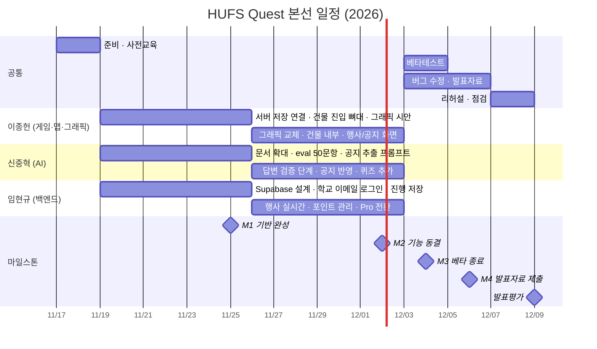

# 🗺 HUFS Quest 본선 로드맵

> **이 문서가 본선 개발 계획의 정본입니다.** 회의에서 바뀐 내용은 그날 PR로 이 파일에 반영합니다.
> 기능이 어디에 있고 무엇과 연결되는지는 [ARCHITECTURE.md](ARCHITECTURE.md)를 보세요.
> 마지막 수정: 2026-11-17 · 다음 마감: **12/2(수) 기능 동결** → **12/6(일) 23:59 발표자료 제출** → **12/9(수) 발표평가**

---

## 1. 한눈에 보기

**원칙:** 1주차에 데이터와 저장 구조를 깔고 → 2주차에 화면 기능을 올리고 → 12/2 이후에는 새 기능 없이 검증과 발표 준비만 합니다.

---

## 2. 우선순위

새 기능을 더 넣기보다 **이미 만든 기능을 실제 데이터로 돌리는 것**이 우선입니다. '반드시'가 밀리면 '여유 시' → '가능하면' 순서로 뺍니다.

| 등급 | 기능 (기획서 항목) | 본선에서 보여줄 수준 | 담당 | 상태 |
| --- | --- | --- | --- | --- |
| 🔴 반드시 | 빠른 검색창 RAG 고도화 (②) | 근거 문서 확대(학칙·학사일정·수강편람), 답변 문장 검증 단계, eval 정답률 수치 | 신중혁 | ⬜ |
| 🔴 반드시 | 마감 임박 공지 실제 반영 (④) | 실제 공지 원문 → HyperCLOVA X 추출 → 팀 검수 → D-day 표시, `[예시]` 항목 삭제 | 신중혁(추출) · 임현규(저장) · 이종헌(화면) | ⬜ |
| 🔴 반드시 | 로그인 · 진행 기록 저장 (⑥) | @hufs.ac.kr 이메일 로그인, 경험치·포인트·퀴즈 기록 서버 저장 | 임현규(서버) · 이종헌(게임 연결) | ⬜ |
| 🔴 반드시 | 맵 그래픽 개선 (①) | 시연 동선 건물을 실제 캠퍼스와 비슷한 도트 그래픽으로 교체 | 이종헌 | ⬜ |
| 🟡 가능하면 | 건물 내부 진입 (①) | 건물 1곳만 내부 맵 구현. **11/30까지 진척 없으면 제외** | 이종헌 | ⬜ |
| 🟡 가능하면 | 교내 행사 실시간 반영 (⑥) | 행사 등록 폼 → 맵 위 이벤트 마커 | 임현규(등록·저장) · 이종헌(맵 표시) | ⬜ |
| 🟡 가능하면 | 퀴즈 확장 (③) | 새 근거 문서로 문제 추가, 퀘스트로 배치 | 신중혁(문제) · 이종헌(배치) | ⬜ |
| 🟢 여유 시 | 다국어 확대 (⑤) | 새 기능 영어 번역 + 용어집, 제3언어 1개 | 신중혁 | ⬜ |

상태 표시: ⬜ 시작 전 · 🟨 진행 중 · ✅ 완료 · ❌ 제외

### 범위 밖 (본선에서 다루지 않음)

기획서(11/10)에서 뺀 기능입니다. **수정하거나 새 기능을 붙이지 않습니다.** 화면에서 숨길지는 [7. 팀이 정할 것](#7-팀이-정할-것) 참고.

- 수강신청 추천 서비스: `public/planner/`, `src/ui/plannerOverlay.js`, `teammate/`
- 모의 수강신청: `src/scenes/MockRegScene.js`

---

## 3. 역할 분담

| 이름 | 주 역할 | 겸하는 역할 |
| --- | --- | --- |
| **이종헌** | PM, 게임 개발(Phaser 로직·UI), 맵·그래픽(Tiled·도트 에셋), 퀘스트 시나리오, 발표 총괄 | 콘텐츠 검수, 발표 시연 |
| **신중혁** | AI 개발(문서 임베딩·RAG·답변 프롬프트·다국어) | 베타테스트 운영(공동), 법·라이선스 기록, 발표 시연 |
| **임현규** | 백엔드(Supabase DB·인증·실시간, 리워드 포인트) | QA·배포 관리, 베타테스트 운영(공동) |

| 겸하는 역할 | 하는 일 | 담당 |
| --- | --- | --- |
| QA·배포 관리 | PR 리뷰, Merge 후 실서비스 확인, 12/2 기능 동결 이후 Merge 승인 | 임현규 |
| 콘텐츠 검수 | 퀴즈 정답·해설, AI가 추출한 공지 날짜, 영어 번역 용어 확인 (만든 사람과 다른 사람이 교차 확인) | 이종헌 |
| 베타테스트 운영 | 테스터 약 20명 모집, 설문, 결과를 발표용 수치로 정리 | 임현규 · 신중혁 |
| 법·라이선스 기록 | 에셋 출처·라이선스 보관, robots.txt 준수 기록, 개인정보 안내 문구 | 신중혁 |
| 발표 시연 | 당일 시연 조작, 오류 시 백업 영상 전환. 발표자가 말하는 동안 다른 한 명이 조작 | 신중혁 · 이종헌 |

### 폴더별 담당

다른 사람 담당 폴더를 고칠 때는 단톡에 먼저 공유합니다. AI 코딩 도구도 이 표를 따릅니다.

| 폴더 / 파일 | 담당 | 내용 |
| --- | --- | --- |
| `src/scenes/`, `src/ui/`, `src/gfx/`, `src/main.js`, `index.html` | 이종헌 | 게임 장면, 화면 UI, 도트 그래픽 |
| `src/data/campus.js`, `src/data/npcs.js`, `src/quizBoxes.js` | 이종헌 | 캠퍼스 맵 데이터, 퀴즈 상자 배치 |
| `api/ask.js`, `shared/kb.js`, `src/data/askApi.js` | 신중혁 | 빠른 검색창 서버 함수와 키워드 검색 |
| `scripts/`, `data/chunks.json` | 신중혁 | 문서 수집 · 임베딩 · 정확도 테스트 |
| `src/data/quiz.js` | 신중혁 | O/X 퀴즈 문항 (검수: 이종헌) |
| `supabase/` (새로 만듦), 새 `api/*` 서버 함수 | 임현규 | DB 스키마, 로그인, 진행 저장, 행사 |
| `shared/deadlines.js`, `shared/deadlineCalc.js`, `api/deadlines.js` | 임현규 (데이터 내용: 신중혁) | 마감 임박 공지 |
| `src/state.js`, `src/quizProgress.js` | 이종헌 · 임현규 **공동** | 게임 상태 ↔ 서버 저장 연결. 고치기 전에 서로 확인 |
| `docs/`, `CLAUDE.md`, `AGENTS.md` | 이종헌 (수정은 누구나 PR로) | 로드맵과 AI 작업 규칙 |
| `campus-map/` | 참고용 (배포 안 됨) | 이전 프로토타입. 건물 진입·Tiled·행사 로직을 가져올 때 참고만 |

---

## 4. 주차별 작업

모든 작업은 **브랜치 → PR → Preview 확인 → Merge** 순서로 진행합니다. 작업을 시작하면 GitHub Issue를 만들고, PR에 `Closes #번호`를 적어 주세요.

### 0주차 · 11/17(화)~11/18(수) 준비

- [ ] 지원금·크레딧 구글폼 제출 (11/17 17시) — 이종헌
- [ ] 개발 환경 세팅과 테스트 PR — 신중혁, 임현규
- [ ] 사전교육 참석(11/18 15시, 본관 1202호), 지출 규정·크레딧 사용 범위 확인 — 전원
- [ ] 로드맵 확정, 유료 도구 결제(Claude, PixelLab) — 이종헌

### 1주차 · 11/19(목)~11/25(수) 기반 다지기

**이종헌 (게임·맵·그래픽)**
- [ ] `src/state.js`의 `session`과 `src/quizProgress.js`의 메모리 기록을 임현규의 저장 API와 연결 (로그인 시 서버 저장, 게스트는 지금처럼 메모리)
- [ ] 건물 진입(장면 전환) 뼈대. `campus-map/js/game.js`의 건물 진입과 `campus-map/js/tiles.js`의 Tiled 내보내기 로직을 참고
- [ ] 시연 동선 건물 선정, PixelLab 그래픽 스타일 시안 1차

**신중혁 (AI)**
- [ ] `scripts/urls.txt`에 학칙 전문·학사일정·수강편람 추가 → `collect` → `ingest` (robots.txt 허용 범위만)
- [ ] `scripts/eval.mjs` 테스트 질문 20개 → 50개 (예: "계절학기 최대 몇 학점?"), 확대 전 정답률 기준선 측정
- [ ] 실제 공지 원문 20건 확인, '무엇을·언제까지·어디서' 추출 프롬프트 설계 (출력은 `shared/deadlines.js` 형식)

**임현규 (백엔드)**
- [ ] Supabase 테이블 설계(사용자, 진행 기록, 퀴즈 기록, 공지, 행사), SQL은 `supabase/` 폴더에 저장
- [ ] 학교 이메일(@hufs.ac.kr)만 허용하는 로그인
- [ ] 진행 저장·불러오기 서버 함수, 퀴즈 중복 보상과 하루 상한(`QUIZ_DAILY_CAP`)을 서버에서 검증

### 2주차 · 11/26(목)~12/2(수) 핵심 기능 완성

**이종헌 (게임·맵·그래픽)**
- [ ] 시연 동선 건물 그래픽 교체(`src/gfx/textures.js`), 건물 내부 1곳 Tiled 맵과 진입 구현
- [ ] 행사 마커 맵 표시, 마감 임박 공지 화면(`src/ui/deadlineOverlay.js`)을 실제 데이터와 연결
- [ ] 새 퀴즈를 맵 퀘스트로 배치

**신중혁 (AI)**
- [ ] 답변 문장을 근거 문서와 한 번 더 대조하는 검증 단계 추가(`api/ask.js`)
- [ ] 공지 추출(HyperCLOVA X) → 팀 검수 → 공지 데이터 반영, `[예시]` 항목 삭제
- [ ] 새 문서 기반 O/X 퀴즈 문항 추가(정답·해설·원문 링크)

**임현규 (백엔드)**
- [ ] 행사 등록 폼과 행사 데이터 실시간 반영(Supabase Realtime)
- [ ] 포인트 관리, 공지 데이터를 Supabase로 옮길지 결정, Supabase Pro 전환(무료 플랜 일시정지 방지)

### 3주차 · 12/3(목)~12/6(일) 검증과 발표 준비 — 새 기능 금지

- [ ] 재학생 베타테스트 약 20명, 사용성 설문 (12/3~12/4) — 임현규·신중혁 운영, 전원 지원
- [ ] 베타에서 나온 버그 수정 — 이종헌(게임 화면), 임현규(서버), 신중혁(검색창)
- [ ] `eval` 최종 정답률 측정, 발표용 수치 정리 — 신중혁
- [ ] 에셋 라이선스·데이터 수집 기록 정리(질의응답 대비) — 신중혁
- [ ] 발표 PPT(10분), 시연 시나리오, 시연 영상 백업 녹화 — 이종헌 총괄, 각자 담당 기능 슬라이드
- [ ] 12/6 23:59까지 PPT 메일 제출 — 이종헌

### 발표 직전 · 12/7(월)~12/9(수)

- [ ] 리허설 2회, 10분 시간 맞추기 — 전원
- [ ] 시연 상태 점검 — 신중혁(CLOVA·검색창), 임현규(Supabase·시연용 계정·데이터)
- [ ] 12/9 발표평가(09:30~12:30, 미네르바컴플렉스 국제회의실)와 시상식(14:30~) — 전원

---

## 5. 마일스톤과 통과 기준

마일스톤 날 밤에 15분 팀 점검을 하고, 기준을 못 맞춘 항목은 바로 범위를 줄입니다.

| 날짜 | 마일스톤 | 통과 기준 |
| --- | --- | --- |
| 11/25(수) | **M1 기반 완성** | 로그인 후 경험치가 서버에 저장됨 · 확대 문서 재임베딩 완료 · eval 50문항 기준선 측정 · 그래픽 시안 확정 |
| 12/2(수) | **M2 기능 동결** | 🔴 반드시 4개가 실서비스(hufs-quest.vercel.app)에서 동작. 이후로는 버그 수정만 Merge |
| 12/4(금) | **M3 베타 종료** | 재학생 20명 내외 사용 기록과 설문 결과 확보 |
| 12/6(일) 23:59 | **M4 발표자료 제출** | PPT 메일 제출, 시연 영상 백업 확보 |
| 12/9(수) | **발표평가** | 10분 발표와 라이브 시연 |

---

## 6. 예상 위험과 대응

| 위험 | 대응 |
| --- | --- |
| 이종헌에게 게임·그래픽·PM·발표가 몰려 화면 작업이 늦어짐 | 건물 내부는 1곳만, 그래픽은 시연 동선만. 11/30까지 진척이 없으면 내부 진입 제외 |
| 문서를 늘렸더니 기존 정답이 틀려짐 | 재임베딩 전후로 같은 eval을 돌려 정답률이 떨어지면 반영하지 않음 |
| 발표장 동시 질문으로 CLOVA 요청 제한(429) 초과 | 자주 묻는 질문 답변 캐시, 재시도 로직, 시연 영상 백업 |
| Supabase 무료 프로젝트가 비활동으로 일시정지 | 로그인 도입 시점부터 발표일까지 Pro 플랜 |
| `src/state.js` 등 공동 파일 동시 수정으로 충돌 | 공동 파일은 수정 전 단톡 공유, 브랜치는 하루 안에 Merge |
| AI가 공지 날짜를 잘못 추출 | 팀 검수 후에만 표시, 항상 원문 링크 함께 표시 |

---

## 7. 팀이 정할 것

- [ ] 팀원별 기말고사·과제 일정을 모아 바쁜 주의 작업량 조정
- [ ] 시연 동선에 넣을 건물과 내부를 구현할 건물 1곳
- [ ] 범위 밖 기능(수강신청 추천 버튼, 모의 수강신청)을 본선 화면에서 숨길지
- [ ] 실제 공지를 어느 부서 게시판에서 가져올지, 학교에 정식 제공을 요청할지
- [ ] 행사 등록 주체(총학생회·과 학생회)에게 시범 등록을 부탁할지
- [ ] 사전교육 답변에 따른 유료 도구 결제 범위와 담당자

---

## 8. 이 문서를 고치는 방법

1. 회의에서 바뀐 내용이 있으면 그날 `docs/roadmap-YYMMDD` 브랜치를 만들어 이 파일을 고칩니다.
2. 아래 변경 기록에 한 줄 추가하고 PR을 올립니다.
3. 진행 상태(⬜🟨✅❌)와 체크박스는 기능 PR을 Merge할 때 같이 고쳐도 됩니다.

### 변경 기록

| 날짜 | 변경 내용 | 작성 |
| --- | --- | --- |
| 2026-11-17 | 본선 로드맵 첫 작성, 역할 재분담(게임·맵·그래픽 이종헌 / AI 신중혁 / 백엔드 임현규) | 이종헌 |
