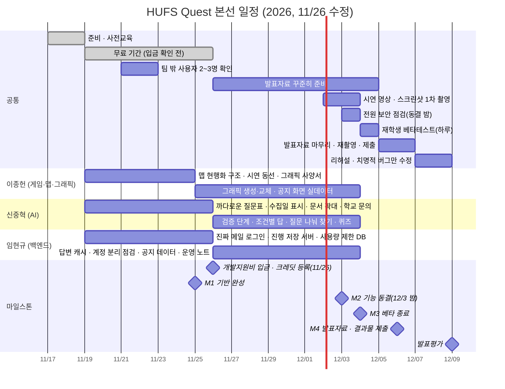

# 🗺 HUFS Quest 본선 로드맵

> **이 문서가 본선 개발 계획의 정본입니다.** 회의에서 바뀐 내용은 그날 PR로 이 파일에 반영합니다.
> **지금 상태 · 열린 PR · 사람별 다음 작업은 [STATUS.md](STATUS.md)를 먼저 보세요.**
> 무엇을 만들고 무엇을 안 만드는지는 [PRD.md](PRD.md), 운영·보안 절차는 [OPERATIONS.md](OPERATIONS.md), 기능 연결은 [ARCHITECTURE.md](ARCHITECTURE.md)를 보세요.
> 마지막 수정: 2026-11-26 · 다음 마감: **11/25(수) M1** → **11/26(목) 개발지원비 입금 · NCP 크레딧 등록 완료** → **12/3(목) 밤 기능 동결(M2) · 전원 보안 점검** → **12/4(금) 재학생 베타테스트** → **12/6(일) 23:59 발표자료 · 결과물 제출** → **12/9(수) 발표평가**

> 💰 **지원금 3종 (11/24 대회 안내 메일, 11/26 확인):** ① 학교 개발지원비 — **11/26 입금 확인, 실수령 456,000원**(500,000원에서 8.8% 원천징수로 추정) ② 네이버클라우드 크레딧 「한국외국어대학교 경진대회 크레딧」 500,000원 — **11/26 메인 계정 등록 완료**, 잔액 497,980원(11/26), 유효기간 2026-11-01~2026-12-31 ③ 네이버클라우드 AI툴 지원금 200,000원 — **미지급**(나중에 지급 예정), 지급 전 사용 계획 없음(예비비). 셋 다 **증빙 제출이 없습니다.** 금액 · 사용 범위는 [5장](#5-예산과-결제-입금-확인-뒤), 입금 확인 당일 순서는 [4장 입금 확인일](#입금-확인일-1126목-확인).
>
> 📤 **12/6(일) 23:59 제출(같은 안내 메일):** 대회 담당 메일(11/24 안내 메일 참고)로 ① 발표자료(PPT) ② 제작 결과물(서비스 링크 등). 발표는 팀당 **10분 이내 + 질의응답 5분**, 시연은 **발표자료 안에 넣는 것을 권장**하고 결과물 링크도 따로 첨부합니다. 발표 순서는 12월 초 안내 예정.
>
> ⚠️ **11/18 변경:** 사전교육 피드백에 따라 건물 내부 진입·행사 실시간은 **제외**했습니다. (예산 지급이 늦어져 결제를 미룬 일정은 위 11/24 내용으로 바뀜)

---

## 1. 한눈에 보기

**원칙:** 1주차(무료 기간)에 데이터·저장·보안 구조를 깔고 → 개발지원비 입금이 확인되면(11/26 확인) 결제하고 그래픽과 화면 기능을 올리고 → 12/3 밤 기능 동결 이후에는 새 기능 없이 베타 · 발표 준비만 합니다.

**동결 규칙 (11/26 확정):** 12/3 밤 이후 새 기능 금지, 데이터는 12/7까지, 치명적 버그 수정은 12/8까지. 대회 마감(12/6 23:59 제출, 12/9 발표)은 그대로입니다.

**발표자료:** 11/26부터 꾸준히 준비합니다(목차 · 시연 대본 → 캡처 → 베타 결과). 12/5~12/6에 마무리합니다.

### 무료 기간 규칙 (11/19~입금 확인 전)

> ✅ **11/26 개발지원비 · NCP 크레딧 입금 확인 완료.** 개발지원비 · 크레딧에 대한 아래 무료 기간 규칙은 끝났고, 결제는 [5장](#5-예산과-결제-입금-확인-뒤) 순서대로 팀이 합니다. AI툴 지원금은 미지급이며 지급 전 사용 계획이 없습니다(예비비).

- **입금이 확인될 때까지 아무것도 결제하지 않습니다.** 개발지원비는 입금 전에도 쓸 수 있다고 안내받았지만(대회 취지에 맞는 용도만) 쓰지 않습니다. → 11/26 입금 확인 완료.
- 유료 플랜 전환도 하지 않습니다. Vercel·Supabase는 무료 플랜, 도트 편집은 무료 도구(Piskel · LibreSprite 등), 맵은 Tiled(무료)로 합니다.
- Claude는 각자 지금 쓰는 요금제로만 씁니다. 에이전트를 여러 개 띄우지 말고 **한 번에 한 기능**씩 시켜 토큰을 아낍니다.
- **eval 규칙(11/26):** 크레딧 등록 완료(11/26, 잔액 497,980원, 12/31 만료). CLOVA Studio 호출(리랭커·검증 호출·더 큰 모델 비교 포함)은 크레딧으로 쓰므로 비용 때문에 줄이지 않는다. 판단 기준은 정답률과 평균 응답 4초. eval 실행 횟수 제한 없음. 단 숨긴 문항(hidden)은 단계 PR의 최종 판단 때만 돌리고, 연속 실행으로 429가 나면 문항 사이에 간격을 둔다. 기준선 비교·실서비스 eval 결과는 PR이나 STATUS에 결과 파일·정답 수를 기록하고, 밤 점검 때 크레딧 잔액을 같이 적는다. 하루 크레딧이 1만 원 넘게 줄면 단톡에 한 줄 공유한다(허락 필요 없음). 사용자당 호출·입력 길이 제한은 남용 방어라 그대로 둔다.
- 유료 도구가 필요한 일은 **사양서·자리표시 그림까지만** 해 두고, 입금 확인 뒤에 합니다.

---

## 2. 우선순위

새 기능을 더 넣기보다 **이미 만든 기능을 실제 데이터로, 안전하게 돌리는 것**이 우선입니다. '반드시'가 밀리면 🟢 → 🟡 순서로 뺍니다.

| 등급 | 기능 (기획서 항목) | 본선에서 보여줄 수준 | 담당 | 상태 |
| --- | --- | --- | --- | --- |
| 🔴 반드시 | 빠른 검색창 RAG 고도화 (②) | 근거 문서 확대, 까다로운 질문 묶음 추가 채점, 답변 검증 단계, **답마다 수집일 표시**(적용 기준 표시는 대회 이후) | 신중혁 | 🟨 |
| 🔴 반드시 | 검색창 비용·남용 방어 (②, 피드백 Top 1) | 사용자(학생 계정 · 게스트 IP)당 1분·하루 횟수와 전체 하루 상한을 Supabase 공용 카운터로, 입력 길이·출력 토큰 상한, NCP 예산 알림 | 임현규(DB) · 신중혁(`api/ask.js` 연결) | 🟨 |
| 🔴 반드시 | 마감 임박 공지 실제 반영 (④) | 원문 대조 손 입력 + 추출 도우미 보조, 12/4~12/7 재보충(발표일 7일 이내 3건 이상) | 임현규(입력·저장) · 신중혁(추출·검수) · 이종헌(화면) | 🟨 |
| 🔴 반드시 | 로그인 · 진행 기록 저장 (⑥) | @hufs.ac.kr 진짜 메일 로그인, 경험치·포인트·퀴즈 기록 서버 저장, 개인정보 안내, A/B 계정 분리 확인 | 임현규(서버·메일) · 이종헌(화면, 가짜 모드 완료) | 🟨 |
| 🔴 반드시 | 맵 그래픽 개선 + 현행화 (①) | 시연 동선 건물 그래픽 교체, 건물 정보 데이터 분리, 맵 기준일·"실제와 달라요" 신고 버튼 | 이종헌 (건물 정보 내용: 임현규) | 🟨 |
| 🟡 가능하면 | 퀴즈 확장 (③) | 새 근거 문서로 문제 추가, 퀘스트로 배치, 출처 링크 점검 | 신중혁(문제) · 이종헌(배치) | ⬜ |
| 🟡 가능하면 | 복합 질문 나눠 찾기 (②) | 질문을 최대 2개 하위 질문으로 나눠 각각 검색 (Advanced RAG). 정답률이 떨어지면 반영 안 함 | 신중혁 | ✅ |
| 🟢 여유 시 | 다국어 (⑤) | 새로 만든 화면 문구의 영어 번역만. **제3언어는 하지 않음** | 신중혁 | ⬜ |
| ❌ 제외 | 건물 내부 진입 (①) | 피드백 권고로 대회 기간 제외. 발표에서 '다음 단계'로 소개 | — | ❌ |
| ❌ 제외 | 교내 행사 실시간 반영 (⑥) | 피드백 권고로 제외(등록 권한·XSS 위험). 발표에서 '다음 단계'로 소개. 11/24: 실시간 · 등록 폼이 아닌 **팀이 원문을 보고 손으로 넣는 행사 표**(`shared/events.js`, 마감 공지와 같은 원칙)만 추가 | — | ❌ |

상태 표시: ⬜ 시작 전 · 🟨 진행 중 · ✅ 완료 · ❌ 제외

### 범위 밖 (본선에서 다루지 않음)

기획서(11/10)와 PRD(11/18)에서 뺀 기능입니다. **수정하거나 새 기능을 붙이지 않습니다.** 전체 목록은 [PRD.md 3장](PRD.md#3-하지-않을-것-대회-기간-1116129).

- 수강신청 추천 서비스: `public/planner/`, `src/ui/plannerOverlay.js`, `teammate/` — 본선 화면에서 버튼만 숨김(이종헌, 1주차)
- 모의 수강신청: `src/scenes/MockRegScene.js` — 진입 버튼만 숨김
- 건물 내부 진입, 행사 실시간·등록 폼, 과제 일정 등록, 제3언어, 학사정보시스템 API 실제 연동, NCP Maps 연동

### NCP 활용 계획 (11/26 종헌 결정)

역할마다 맞는 NCP 모델을 씁니다. 호출 비용은 크레딧으로 내고, 판단 기준은 [eval 규칙](#무료-기간-규칙-1119입금-확인-전)과 같습니다(정답률 · 평균 응답 4초).

| 역할 | NCP 모델 · 기능 | 상태 | 담당 · 날짜 |
| --- | --- | --- | --- |
| 질문 정제 · 분석(검색어 정리, 하위 질문 나누기) | HCX-DASH-002 | 사용 중 | 신중혁 |
| 벡터화(문서 조각 · 질문) | CLOVA 임베딩 v2 | 사용 중 | 신중혁 |
| 답변 | HCX-005 | 사용 중 | 신중혁 |
| 검색 결과 다시 순위 매기기 | CLOVA 리랭커 | eval에서 켬/끔 비교. **정답률이 오르고 평균 응답 4초 이내면 반영** | 신중혁 |
| 공지 마감일 추출 | HCX-007 + Structured Outputs | 추가 예정. 공지 흐름은 [OPERATIONS.md 7장](OPERATIONS.md#7-학교-협의-기록) | 신중혁(추출, 11/28) · 임현규(지금 도우미로 실제 1건 11/28, HCX-007 연결·실제 1건 11/30) |
| 공지 제목 분류 | HCX-DASH-002 | 하지 않음(Actions에 NCP 키를 넣지 않음, 키워드로 충분) | — |

**하지 않을 것:** 임베딩 모델 교체, 벡터 DB의 NCP 이전(Supabase 그대로), HCX-007을 실시간 답변에 쓰기.

**발표용 숫자:** 발표에 쓸 NCP 사용 숫자는 `docs/NCP_USAGE.md`에 정리합니다 — 신중혁, 12/3.

---

## 3. 역할 분담

| 이름 | 주 역할 | 겸하는 역할 |
| --- | --- | --- |
| **이종헌** | PM, 게임 개발(Phaser 로직·UI), 맵·그래픽(도트 에셋), 퀘스트 시나리오, 발표 총괄 | 콘텐츠 검수, 발표 시연 |
| **신중혁** | AI 개발(문서 임베딩·RAG·답변 프롬프트·질문표) | 베타테스트 운영(공동), 법·라이선스 기록, **학교 협의 창구**, 발표 시연 |
| **임현규** | 백엔드(Supabase DB·인증·메일·진행 저장·사용량 제한·답변 캐시) | QA·배포 관리, **매일 5분 점검**, 베타테스트 운영(공동) |

> **11/18 재조정:** 피드백에서 "한 사람이 맵·그래픽과 백엔드를 함께 맡아 병목"이라는 지적을 받았습니다. 행사 실시간이 빠지면서 생긴 임현규의 2주차 여유를 **진짜 메일 로그인 설정, 사용량 제한 DB, 건물 정보 데이터 입력, 공지 데이터 입력**으로 옮겨 이종헌은 화면·그래픽에 집중합니다.

| 겸하는 역할 | 하는 일 | 담당 |
| --- | --- | --- |
| QA·배포 관리 | PR 리뷰, Merge 후 실서비스 확인, 12/3 밤 기능 동결 이후 Merge 승인 | 임현규 |
| 매일 5분 점검 | 접속·에러·429·CLOVA 비용·Supabase 사용량 확인 ([OPERATIONS.md 3장](OPERATIONS.md#3-매일-5분-점검-담당-임현규-바쁜-날은-다른-사람이-대신)) | 임현규 |
| 콘텐츠 검수 | 퀴즈 정답·해설, 공지 날짜, 건물 정보, 영어 번역 용어 확인 (만든 사람과 다른 사람이 교차 확인) | 이종헌 |
| 베타테스트 운영 | 사전 사용자 2~3명(1주차) + 재학생 약 20명(3주차) 모집, 설문, 결과를 발표용 수치로 정리 | 임현규 · 신중혁 |
| 법·라이선스 기록 · 학교 협의 | 에셋 출처·라이선스 보관, robots.txt 준수 기록, 개인정보 안내 문구, 학교 문의 메일 | 신중혁 |
| 발표 시연 | 당일 시연 조작, 오류 시 백업 영상 전환. 발표자가 말하는 동안 다른 한 명이 조작 | 신중혁 · 이종헌 |

### 폴더별 주 담당

**주 담당은 책임자이지 독점이 아닙니다.** 일이 몰리거나 먼저 손이 비는 사람이 있으면 누구든 다른 영역의 작업을 가져가서 해도 됩니다. 허락은 필요 없고, 아래 두 가지만 지킵니다.

1. **기록 남기기**: 모든 작업은 브랜치 → push → PR → Merge로 GitHub에 남깁니다. PR 설명의 "작업 기록" 칸에 작업한 사람과, 주 담당이 다른 파일을 적습니다.
2. **충돌 피하기**: 큰 작업을 시작할 때 단톡에 "○○ 작업 시작" 한 줄을 남깁니다. 같은 파일을 동시에 고치는 일을 막기 위해서입니다.

실서비스 DB를 바꾸는 `npm run ingest`, Supabase 테이블 구조 변경, Vercel 환경 변수 변경은 누가 하든 실행한 사실을 PR에 꼭 적습니다.

| 폴더 / 파일 | 주 담당 | 내용 |
| --- | --- | --- |
| `src/scenes/`, `src/ui/`, `src/gfx/`, `src/main.js`, `index.html` | 이종헌 | 게임 장면, 화면 UI, 도트 그래픽 |
| `src/data/campus.js`, `src/data/npcs.js`, `src/quizBoxes.js` | 이종헌 | 캠퍼스 맵(건물 ID·위치), 퀴즈 상자 배치 |
| `src/data/buildingInfo.js` (새로 만듦) | 이종헌(형식) · 임현규(내용) | 건물 이름·용도·층별 사무실·출처·마지막 확인일·상태(공사 중/신규) |
| `api/ask.js`, `shared/kb.js`, `src/data/askApi.js` | 신중혁 | 빠른 검색창 서버 함수와 키워드 검색 |
| `scripts/`, `data/chunks.json` | 신중혁 | 문서 수집 · 임베딩 · 정확도 테스트 |
| 검색창 개선 1~4단계 (`scripts/`, `data/`) | 이종헌 | 복잡한 표를 조건 포함 문장 조각으로 정리·검수·ingest·eval (완료). 5단계 이후(`api/ask.js`)는 신중혁 |
| `src/data/quiz.js` | 신중혁 | O/X 퀴즈 문항 (검수: 이종헌) |
| `supabase/`, 새 `api/*` 서버 함수, `api/_lib/` | 임현규 | DB 스키마, 로그인, 진행 저장, 사용량 제한, 답변 캐시 |
| `shared/deadlines.js`, `shared/deadlineCalc.js`, `api/deadlines.js` | 임현규 (데이터 검수: 신중혁) | 마감 임박 공지 |
| `src/state.js`, `src/quizProgress.js`, `src/data/progressApi.js`, `src/data/progressMock.js`, `shared/progressRules.js` | 이종헌 · 임현규 | 게임 상태 ↔ 서버 저장 연결 (규칙은 `docs/PROGRESS_API.md`) |
| `docs/`, `CLAUDE.md`, `AGENTS.md` | 이종헌 (수정은 누구나 PR로) | PRD, 로드맵, 운영 노트, AI 작업 규칙 |
| `campus-map/` | 참고용 (배포 안 됨) | 이전 프로토타입. 건물 내부·행사는 제외됐으므로 참고할 일 거의 없음 |

---

## 4. 주차별 작업

모든 작업은 **브랜치 → PR → Preview 확인 → Merge** 순서로 진행합니다. 작업을 시작하면 GitHub Issue를 만들고, PR에 `Closes #번호`를 적어 주세요.

### 0주차 · 11/17(화)~11/18(수) 준비

- [ ] 지원금·크레딧 구글폼 제출 (11/17 17시) — 이종헌
- [ ] 개발 환경 세팅과 테스트 PR — 신중혁, 임현규
- [x] 사전교육 참석(11/18), 팀 피드백 수령 → PRD·운영 노트·로드맵 반영 (11/18)
- [ ] ~~유료 도구 결제~~ → **입금 확인 뒤로 연기** (11/24 답신: 11/27 금까지 지급 예상 → 11/26 입금 확인)

### 1주차 · 11/19(목)~11/25(수) 기반 다지기 — 무료 기간

**공통**
- [x] 11/19 NCP 콘솔 Budgets 알림 50% · 80% · 100% 설정 — NCP 메인 계정 주인 (11/19 완료, 분기별 2026-4Q · 50만 원, [OPERATIONS.md 3장](OPERATIONS.md#3-매일-5분-점검-담당-임현규-바쁜-날은-다른-사람이-대신))
- [x] 11/19 [OPERATIONS.md 1장](OPERATIONS.md#1-계정--결제-주인-팀이-채울-것) 계정 · 결제 주인 표 채우기 — 전원 (11/19)
- [ ] 11/21~22 팀 밖 재학생(학과 동기, 팀이 섭외) 2~3명에게 지금 배포본을 보여 주고 "이중전공 기준 찾기"를 시켜 보기. 불편하다는 말과 걸린 시간을 기록 — 임현규·신중혁

**이종헌 (게임·맵·그래픽)**
- [x] 진행 저장 화면 쪽 가짜 모드 연결, 학교 이메일 6자리 코드 로그인 화면 (11/17~18)
- [x] 검색창 개선 1~4단계: 표 정리 조각(216 → 242조각), eval 43/45 유지 (11/17)
- [x] 건물 정보 분리: `src/data/buildingInfo.js` 형식 정의(건물 ID 기준). 맵 그림·`campus.js`에는 ID와 위치만 남기기 (11/19, 내용 입력은 임현규)
- [x] 화면에 "2026년 11월 기준 캠퍼스" 맵 기준일 + 공식 캠퍼스 지도 링크 + **"실제와 달라요" 신고 버튼**(외부 신고 폼 링크, 개인정보 받지 않음) (11/19, 전체 지도 화면. **신고 폼 연결 완료, 근처 건물 미리 채움**: 구글 폼은 `scripts/report-form/createReportForm.gs`로 만들고 `buildingInfo.js`의 `REPORT_FORM_URL` · `REPORT_FORM_PLACE_ENTRY`에 연결. 폼에 보내는 값은 건물 이름 하나뿐. 응답 확인 이종헌)
- [x] 로그인 화면에 개인정보 안내 4줄(문구: 신중혁, [OPERATIONS.md 8장](OPERATIONS.md#8-개인정보)) (11/19, 1단계에 4줄 + 동의 체크박스, 체크해야 "인증 코드 받기" 켜짐. 문구 초안은 이종헌 작성 → 신중혁 확인 필요)
- [x] 범위 밖 버튼(수강신청 추천, 모의 수강신청) 숨김 (11/19, `src/data/features.js`의 `SHOW_OUT_OF_SCOPE = false`, true로 바꾸면 다시 보임)
- [x] 건물 정보에 사무실 · 시설 형식(층 · 호수 · 하는 일 · 출처) 추가, 공식 페이지 기준 10개 건물 입력, 2026 신입생 대학생활안내의 '서울캠퍼스' 표기 부분만 건물 정보 · 검색창 조각으로 반영(`data/manual/`) (11/20, #31)
- [x] 도서관 자료실 이용시간을 요일 · 기간별 한 줄씩으로 분리 — 검색창이 "학기 중 토요일도 21시"로 합쳐 답하던 문제 수정. ingest 250 → 246조각 (11/20, #36)
- [ ] 검색창 문서 확대(27 → 74곳, 시험 DB 468조각, #41) + 질문 쪼개기 · 하위 질문별 동시 검색(#42) — 11/20 밤 Preview 확인 완료, **11/21 eval 비교 후 실서비스 전환**([STATUS.md](STATUS.md) 4장). 신중혁 영역을 이종헌이 대신 작업
- [x] 시연 동선 확정: 정문 → 사이버관 → 본관 → 도서관 → 외국어연수평가원 ([GRAPHICS.md](GRAPHICS.md) 10장, 11/22). 시연 시나리오 초안('한 사람' 기준)은 남음
- [x] 그래픽 사양서 [`docs/GRAPHICS.md`](GRAPHICS.md): 1타일 4m · 88×90 · 북쪽 위, 공식 좌표 기준 배치, 24색 팔레트, 바닥 · 건물 규칙, 무료 도구 (11/22). 생성 프롬프트 대신 **코드 · 직접 찍은 도트만** 쓰기로 함(참고 사진은 따라 그리기만, 저장소에 넣지 않음)

**신중혁 (AI)**
- [x] 11/20까지 학교 문의 메일(공개 학사 자료 활용 및 담당 부서 안내 요청) — [OPERATIONS.md 7장](OPERATIONS.md#7-학교-협의-기록) (11/19 발송·답신: 공개 정보는 검색 근거로 활용 가능, 개인정보 제외·시스템 부담 유의)
- [x] 11/25 학사정보시스템 공식 Open API 존재 여부 및 이용 절차 신규 문의 (메일 발송 완료, 회신 대기. 실제 연동은 본선 개발 범위에서 제외) → 11/26 답신: Open API 없음(#85)
- [ ] `scripts/eval.mjs`에 **까다로운 질문 묶음** 추가: 규칙 무시 요구 3, 태그 삽입 요구 2, 복합 질문 3, 한영 섞인 질문 2, 이름 비슷한 제도 2 → 바꾸기 전 기준선 측정 (지금 50문항: 11/20부터 학사 47 · 범위밖 3. 기준선은 기존 45문항 정답 43 + 범위밖 3/3)
- [x] **수집일 표시**: 기존 조각의 `collected_at`을 조회하여 검색창 출처에 한·영 수집일 표시 (11/25 구현 및 Preview 한·영·모바일 가로 화면 검수 완료, PR #74)
- [ ] **적용 기준 표시(몇 학기·몇 학번부터)**: 대회 종료 이후로 연기
- [ ] `scripts/urls.txt`에 학칙 전문·학사일정·수강편람 추가 → `collect` → 검수 → `ingest` → eval (robots.txt 허용 범위만, 떨어지면 반영 안 함)
  - 11/19 학교 답신 반영: robots.txt로 막힌 공개 첨부(수강편람 · 학칙 개정 공지)는 자동 수집하지 않고 팀원이 직접 내려받아 `data/manual/`로(원문 링크 · 확인 날짜 기록, 개인정보 제외)
  - 11/20: 학사일정(11360) **2차 보류**(이종헌, #36). "2027년 1학기 개강일이 언제야?"에 겨울방학 조각의 수강신청 시작일(2027.02.22)을 개강일로 답함. 날짜가 근거에 있어 날짜 검사로 못 막음 → 조각에 적용 학년도 범위 문장 + "질문한 일정 이름이 근거에 있을 때만 답" 지시문 보강 후 11/21 재반영 예정. 지금 실서비스 검색창 DB 246조각
- [x] 검색창 날짜 근거 검사(11/20, 이종헌이 대신 작업 · 리뷰 신중혁): 한국 시간 오늘 날짜 · 현재 학기를 지시문에 전달, 근거에 없는 날짜(연-월-일 · 월-일) · 연도(YYYY학년도 · YYYY년)는 "찾지 못함"으로(`shared/academicDate.js`). eval 범위 밖 2문항을 학사로 옮김. **학사일정(11360) 재수집 · ingest는 이 PR Merge 후**
- [ ] `api/ask.js` 출력 토큰 상한을 실제 답 길이에 맞게 줄이기(지금 1000), 임현규의 공용 카운터 연결
  - 11/18: 1000으로 올린 뒤 eval `20261118-2306` 정답 43/45(변화 없음), 한국어 답 중앙값 86자 · 최대 522자, 잘린 답 없음. CLOVA 문서에 글자↔토큰 환산이 없어 **Vercel 로그에 `completionTokens` · `finishReason` · 답 글자 수를 남기도록 함** → eval 한 번 더 돌려 최댓값을 보고 상한 결정
  - 11/19: 공용 카운터 연결 코드 완료(`api/_lib/usageLimit.js`, 분당 10 · 하루 50 · 전체 500, Supabase 실패 시 메모리 제한으로 대체, eval 토큰 `ASK_EVAL_TOKEN`). **Preview 확인 · 토큰 상한 결정은 아직**
  - 11/19 실서비스 확인: 화면 입력 200자 차단 · 1분 제한(`reason: minute`) · 하루 제한(`reason: day`) · 429 응답(신중혁), 서버 201자 요청 400 "question too long"(이종헌). 로그 `limit` 값을 `db` / `memory-first`(1차 제한, 정상) / `memory-fallback`(공용 카운터 장애)으로 나눔 → 판독은 [OPERATIONS.md 3장](OPERATIONS.md#3-매일-5분-점검-담당-임현규-바쁜-날은-다른-사람이-대신)
  - 11/19 버그 수정: 같은 와이파이(같은 IP) 사용자끼리 하루 · 1분 한도를 나눠 써서 한 사람이 다 쓰면 다른 사람도 막히던 문제(임현규 제보) → **로그인 학생은 계정 기준(하루 50), 게스트는 IP 기준(하루 150)**, 전체 500은 그대로. 베타테스트 · 발표장(학교 와이파이) 대비

**임현규 (백엔드)**
- [x] 진짜 메일 로그인: 무료 외부 SMTP 연결, 메일 발송 한도를 베타 20명에 맞게 조정, 학교 메일만 허용하는 Auth Hook ([AUTH_SETUP.md](AUTH_SETUP.md) 4·6장) (11/19)
- [x] 진행 저장·불러오기 서버 함수, 퀴즈 중복 보상과 하루 상한을 서버에서 검증 (11/19, 11/19 확인 완료)
- [x] `supabase/003_usage_limits.sql`: 검색창 사용량 카운터(IP 해시 · 1분 · 하루 · 전체 하루 상한), RLS 켜기, `anon` 실행 권한 회수
  - 11/18: SQL 작성 · 대시보드 실행 완료(`ask_hit` 함수, 분당 · 전체 초과 · 권한 · RLS 확인, 시험 행 정리). 11/19 `api/ask.js` 연결 코드 완료(위 신중혁 항목)
- [ ] 건물 정보 내용 입력(이름·용도·층별 학과 사무실·출처·확인일). 공식 캠퍼스 안내 페이지 기준 (11/20 빈 건물 3/7 채움: 법학관 · 외국어연수평가원 · 정문안내실)
  - 11/20 #32: 근거를 못 찾은 Minerva Complex · 출판부 · 역사관 · 교수연구동은 `PENDING`에 찾아본 페이지와 함께 기록
  - 11/20 위치 정정(#32 · #37, 이종헌 확인): 학사종합지원센터 → **사이버관 105호**, 원스톱서비스센터 → **국제학사 1층 114호**(원스톱 사이트의 118호는 옛 정보)
  - 다음: 기존 offices 줄 단위 교차 확인(11/20은 건물 단위로만 확인됨)
  - 11/25 #71 피드백: AED 줄 삭제, 호수 → 층 규칙(지하층 되살림, 도서관 제외), 88p 편의시설 전화(010 제외), 동아리방 66개(국제학사 · 사회과학관 · 교수학습개발원 · Minerva Complex 지하캠퍼스), 학과(부) 사무실 42줄(본관 · 사회과학관 · 사이버관), 인문과학관 2층 대강당 · 오바마홀(B1 · B2) · 정보시스템팀(446호) · 빵명장(도서관 뒤) 추가, 여행사 줄 삭제. 외부 참고 출처(종헌이 준 주소만) 허용
- [x] 실제 공지 11건 손 입력 완료(`shared/deadlines.js`, 게시판 자동 수집 금지, 원문 대조 기록 `checked` 및 `startsAt` 반영, 예시 5건 `DEMO_DEADLINES`로 분리)
  - 11/20 #34: 학사종합지원센터 · HUFS Dorm · 장학팀 공지 6건(11/27~12/11 마감), 입력 규칙 테스트 `tests/deadlines.test.js` 추가. 신중혁 교차 검수 중
  - 12/9 발표 당일 화면(마감 7일 이내만 표시)에 뜨는 실제 공지가 1건(12/11)뿐 → 12/9~12/16 마감 공지 우선 보충

### 입금 확인일 (11/26(목) 확인)

개발지원비 입금이 확인된 날 아래 순서로 합니다. AI툴 지원금은 미지급이므로 이날 결제는 **모두 개발지원비에서** 합니다. 금액은 [5. 예산](#5-예산과-결제-입금-확인-뒤).

1. 입금액 확인 → 단톡에 공유 — **11/26 입금 확인, 실수령 456,000원**(500,000원에서 8.8% 원천징수로 추정)
2. 네이버클라우드 크레딧 등록 · 잔액 확인 — **11/26 메인 계정 등록 완료**: 「한국외국어대학교 경진대회 크레딧」 500,000원, 잔액 497,980원(이미 2,020원 사용), 유효기간 2026-11-01~2026-12-31
3. Claude 구독 결제(Max 1 + Pro 2) — 개발지원비
4. 베타테스트(12/4) 사례 준비 — 개발지원비
5. Supabase Pro는 이날 결제하지 않고 **12/2에 결정**(무료 플랜 유지가 우선)

결제 내역(영수증 · 카드 내역)은 증빙 제출이 없어도 **팀 정산용으로 보관**합니다([OPERATIONS.md 1장](OPERATIONS.md#1-계정--결제-주인-팀이-채울-것)).

### AI툴 지원금 (미지급, 나중에 지급 예정)

- 11/24 메일에서는 12/1 지급 예상이었지만 11/26 기준 **미지급**이며 나중에 지급될 예정입니다. 지급 전 사용 계획은 없습니다.
- 네이버클라우드 AI툴 지원금 200,000원이 들어오면 금액을 확인해 단톡에 공유하고 **예비비로** 둡니다.

### 2주차 · 11/26(목)~12/3(목) 핵심 기능 완성(그래픽 포함) — 12/3 밤 동결

**전원**
- [ ] 발표자료 꾸준히 준비: 목차 · 시연 대본 → 캡처 → 베타 결과(12/4 저녁) 순서로 채움 — 이종헌 총괄

**이종헌 (게임·맵·그래픽)**
- [ ] 시연 동선 건물 그래픽 생성·교체(`src/gfx/textures.js`). 동선 밖 건물은 지금 그림 유지
- [x] 마감 임박 공지 화면(`src/ui/deadlineOverlay.js`)을 실제 데이터와 연결 (14일 이내 기준 · `접수 예정` 배지 · `확인 MM.DD` 표기 · `?demoDeadlines=1` 분리)
- [ ] 퀘스트 목적지·퀴즈 배치를 건물 ID로 연결(이미 `quest.destination`은 ID), 새 퀴즈 배치
- [ ] 진행 저장 `VITE_PROGRESS_MODE=real` 전환 후 Preview에서 임현규와 확인

**신중혁 (AI)**
- [ ] 답변 문장을 근거 문서와 한 번 더 대조하는 검증 단계 추가(`api/ask.js`)
- [ ] 검색창 개선 5단계: 캠퍼스·학번·단과대학 조건이 없는 질문은 조건별로 나눠 답하는 지시문, eval '2025학번 졸업학점' 문항 분리
- [x] (가능하면) 복합 질문을 최대 2개 하위 질문으로 나눠 각각 검색. 호출이 늘어나므로 하위 질문 수 상한 고정 (11/21 #42 실서비스 반영)
- [ ] 공지 추출(HyperCLOVA X, 팀원이 원문을 붙여 넣는 방식) → 팀 검수 → 반영, `[예시]` 삭제
  - [x] 11/24 공지 추출 도우미 개선(신중혁, #59 후속): 한국어 날짜·시간 형식 지원, 원문 근거 검증, 파일 경로·원문 URL 입력, `shared/deadlines.js` 입력용 초안 출력. #58 실제 공지 5건 마감일 일치(5/5), 전체 테스트 207/207 통과. 담당 부서 확인 필요 1건. 팀 검수 후 데이터 반영은 별도 진행.
- [ ] 새 문서 기반 O/X 퀴즈 문항 추가(정답·해설·원문 링크), 퀴즈·NPC 대사 출처 링크 점검

**임현규 (백엔드)**
- [ ] 같은 질문 답변 캐시(Supabase, ingest하면 비움) — 발표장 동시 질문 대비
- [ ] A/B 계정으로 남의 기록이 안 보이는지 확인, 결과를 PR에 기록
- [ ] 공지 데이터 10건 이상 완료, 신중혁 교차 검수
- [ ] 새 공지 알림 + AI 초안 흐름(작업지시서 11/26 작업 1, [NOTICE_FLOW.md](NOTICE_FLOW.md)): 목록 4곳 자동 확인 Actions · `notice:draft` · `checked` 없는 항목 API 제외 — 11/26 구현 PR, 11/28 실제 1건(지금 도우미), 11/30 HCX-007 연결 · 실제 1건
- [ ] Supabase Pro 전환 여부 결정(12/2), 베타 통계 내보내기 방법(이메일 없이 숫자만)

**12/3(목) 밤 기능 동결(M2) + 전원 보안 점검** — [OPERATIONS.md 4장](OPERATIONS.md#4-배포-전-5분-점검) 체크리스트를 실서비스에서 전부 실행

**12/2(수)~12/3(목) 시연 영상 · 스크린샷 1차 촬영 (발표자료에 시연 넣기)** — 안내 메일이 시연을 발표자료 안에 넣으라고 권장하므로, 기능 동결 전 실서비스에서 시연 동선(정문 → 사이버관 → 본관 → 도서관 → 외국어연수평가원)과 검색창 · 퀴즈 · 마감 공지 화면의 **시연 영상과 스크린샷**을 찍어 둡니다. 동결 뒤 바뀐 화면이 있으면 12/5~12/6에 그 부분만 다시 찍습니다. 개인정보(실제 학교 메일 등)가 보이지 않게 시연용 계정으로 찍습니다. — 이종헌(화면) · 신중혁(검색창)

### 3주차 · 12/4(금)~12/6(일) 베타테스트와 발표자료 — 새 기능 금지

- [ ] 재학생 베타테스트 하루(12/4 금, 약 20명), 사용성 설문, **저녁에 결과 집계** — 임현규·신중혁 운영, 전원 지원
- [ ] 마감 임박 공지 재보충(12/4~12/7): 12/9 발표 당일 7일 이내 마감 공지가 3건 이상 보이게. 데이터만 바꾸므로 기능 동결 예외(8장) — 임현규(입력) · 신중혁(검수)
- [ ] 베타에서 나온 버그 수정(치명적 버그는 12/8까지) — 이종헌(게임 화면), 임현규(서버), 신중혁(검색창)
- [ ] `eval` 최종 정답률(기본 묶음 + 까다로운 묶음) 측정, 발표용 수치 정리 — 신중혁
- [ ] 에셋 라이선스·데이터 수집 기록·학교 협의 결과 정리(질의응답 대비) — 신중혁
- [ ] 발표 PPT 마무리(12/5 토~12/6 일, 발표 10분 이내 + 질의응답 5분): 문제 정의 한 문장, 하지 않을 것, 정답률, 비용 방어, 개인정보, 운영 계획, 베타 결과 포함. **시연 영상 · 스크린샷을 PPT 안에 넣고, 바뀐 화면만 재촬영** — 이종헌 총괄
- [ ] 시연 시나리오, 시연 영상 백업 — 이종헌
- [ ] 12/6(일) 23:59까지 대회 담당 메일(11/24 안내 메일 참고)로 ① 발표자료(PPT) ② 제작 결과물(서비스 링크 https://hufs-quest.vercel.app 등)을 제출. 결과물 링크는 PPT 안에 있어도 메일에 따로 적음 — 이종헌

### 발표 직전 · 12/7(월)~12/9(수)

- [ ] 리허설 2회(12/7~12/8), 발표 10분 이내로 맞추고 질의응답 5분 예상 질문 연습 — 전원
- [ ] 치명적 버그만 수정(12/8까지), 마감 공지 재보충(데이터, 동결 예외, 12/7까지) — 해당 담당
- [ ] 발표 순서 안내(12월 초 예정) 확인 · 단톡 공유 — 이종헌
- [ ] 시연 상태 점검 — 신중혁(CLOVA·검색창), 임현규(Supabase·시연용 계정 2개·데이터)
- [ ] 12/9 발표평가(09:30~12:30, 미네르바컴플렉스 국제회의실)와 시상식(14:30~) — 전원

### 대회 후 · 12/10~12/31

- [ ] 개인정보 일괄 삭제(12/31까지), 키 폐기 또는 계속 운영 결정 — [OPERATIONS.md 9장](OPERATIONS.md#9-대회-후-이관-체크리스트-1210-이후)
- [ ] robots 허용 목록 페이지만 확인해 새 공지 후보를 이슈로 만드는 자동화 → 11/26 앞당겨 진행([OPERATIONS.md 7장](OPERATIONS.md#7-학교-협의-기록) 공지 흐름)

---

## 5. 예산과 결제 (입금 확인 뒤)

> 남은 결제 계획 · 예비비 계산 · 결제 장부는 **[BUDGET.md](BUDGET.md)**가 정본입니다. 아래 표의 11/26 금액은 BUDGET.md 2 · 3장과 같습니다.

현금은 **개발지원비 실수령 456,000원**(11/26 입금)이 기준입니다. AI툴 지원금 200,000원은 미지급이며 들어오면 **예비비**로 둡니다. 네이버클라우드 크레딧 500,000원은 NCP(CLOVA Studio 등)에서만 쓰고 현금과 섞지 않습니다.

**지원금 3종 (11/24 대회 안내 메일, 진로취업지원센터 · 11/26 확인)**

| 지원금 | 금액 | 지급 (11/26 확인) | 사용 범위 | 증빙 |
| --- | --- | --- | --- | --- |
| 학교 개발지원비 | 팀당 50만 원 | **11/26 입금 확인, 실수령 456,000원**(500,000원에서 8.8% 원천징수로 추정) | AI 서비스 이용료 등 개발에 필요한 항목에 자유롭게 | 제출 없음 |
| 네이버클라우드 AI툴 지원금 | 팀당 20만 원 | **미지급**(나중에 지급 예정). 지급 전 사용 계획 없음(예비비) | 개발 관련 항목에 자유롭게 | 영수증 등 제출 없음 |
| 네이버클라우드 크레딧 | 팀당 50만 원 상당 | **11/26 메인 계정 등록 완료**: 「한국외국어대학교 경진대회 크레딧」 500,000원, 잔액 497,980원(11/26), 유효기간 2026-11-01~2026-12-31 | NCP(CLOVA Studio 등) 사용료 | — |

- 개발지원비 · 크레딧은 **입금 확인 완료(11/26)**. 결제는 아래 표 순서대로 팀이 합니다.
- AI툴 지원금은 **미지급, 지급 전 사용 계획 없음(예비비)**. 그래서 입금 당일 결제(Claude 구독, 베타 사례)는 **개발지원비에서** 합니다.
- 증빙 제출은 없지만 결제 내역은 **팀 정산용으로 보관**합니다.

| 순서 | 항목 | 원래 계획 | 11/18 제안 · 11/24 수정 · **11/26 결정** |
| --- | --- | --- | --- |
| 1 | Claude Max 1 + Pro 2 | 약 22.4만 | 그대로. **11/26 개발지원비로 결제**(Max 약 159,500 + Pro 약 31,900 × 2 = 약 223,300원) |
| 2 | 그래픽 생성 도구 | Retro Diffusion 7.2만 + PixelLab 3.8만 | **PixelLab(약 3.8만) 11/26 결제 확정, 개발지원비.** Retro Diffusion(약 7.2만)은 **조건부**: 11/30까지 PixelLab 스프라이트 품질이 부족할 때만, 12/1 AI툴 지원금이 들어온 뒤 그 돈에서. 12/1 이후 구매 안 함 |
| 3 | Aseprite | 약 3.2만 | **11/26 결제 확정, 개발지원비** |
| 4 | 상업용 타일 에셋팩 | 약 3만 | **하지 않음**(화풍 · 라이선스) |
| 5 | Supabase Pro | 약 4만 | **12/2에 결정, 무료 플랜 유지가 우선**(약 39,900원). 매일 쓰는 동안은 무료 플랜 일시정지(비활동 기준) 위험이 낮음 |
| 6 | 베타테스트 사례 | 약 6만 | 그대로(20명 × 3,000원 = 약 60,000원). 베타 12/4 하루, 종료 뒤 지급 |
| — | 예비비 | 약 20만 | 아래 계산. 예비비 20만 원은 12/1 AI툴 지원금 입금 후 회복. 절약분도 예비비에 더함 |

**11/26 실수령 기준 계산 ([BUDGET.md 3장](BUDGET.md#3-예비비-계산)):** 개발지원비 실수령 456,000원 − Claude Max 1 + Pro 2(약 223,300원) − Aseprite · PixelLab(약 70,000원) − 베타테스트 사례(약 60,000원) = **약 102,700원 남음**(Supabase Pro를 하면 약 62,800원). AI툴 지원금 200,000원이 12/1 들어오면 예비비는 약 26~30만 원으로 회복됩니다(Retro Diffusion을 사면 그 돈에서 약 7.2만 원이 빠짐).

---

## 6. 마일스톤과 통과 기준

마일스톤 날 밤에 15분 팀 점검을 하고, 기준을 못 맞춘 항목은 바로 범위를 줄입니다.

| 날짜 | 마일스톤 | 통과 기준 |
| --- | --- | --- |
| 11/25(수) | **M1 기반 완성** | 진짜 학교 메일로 로그인 후 경험치가 서버에 저장 · 검색창 공용 사용량 제한 실서비스 적용 · NCP 예산 알림 설정 · 까다로운 질문 묶음 포함 기준선 측정 · 건물 정보 데이터 분리 · 팀 밖 사용자 2~3명 확인 완료 · 그래픽 사양서 완성 |
| 12/3(목) 밤 | **M2 기능 동결** | 🔴 반드시 5개가 실서비스(hufs-quest.vercel.app)에서 동작 · 12/3 전원 보안 점검 통과. 이후 새 기능 금지, 데이터는 12/7까지, 치명적 버그 수정은 12/8까지 |
| 12/4(금) | **M3 베타 종료** | 재학생 20명 내외 하루 사용 기록과 설문 결과 확보, 저녁 결과 집계 |
| 12/6(일) 23:59 | **M4 발표자료 · 결과물 제출** | 대회 담당 메일(11/24 안내 메일 참고)로 ① 발표자료(PPT, 시연 영상 · 스크린샷 포함) ② 제작 결과물(서비스 링크 등, 메일에 따로 첨부) 제출 |
| 12/9(수) | **발표평가** | 발표 10분 이내 + 질의응답 5분. 시연은 발표자료 안에 넣음(안내 권장). 발표 순서는 12월 초 안내 |

---

## 7. 예상 위험과 대응

| 위험 | 대응 |
| --- | --- |
| 결제가 입금 확인(11/26 확인) 뒤로 밀려 그래픽 작업이 1주 안으로 압축 | 1주차에 사양서·프롬프트·자리표시 그림까지 끝내고, 그래픽은 시연 동선 3~4곳만. 12/3까지 못 끝낸 건물은 지금 그림 유지 |
| 검색창을 누구나 마구 호출해 토큰 폭주 (하루 약 11만 토큰 사용 중) | 공용 카운터로 사용자(학생 계정 · 게스트 IP)당·전체 하루 상한, 입력·출력 길이 상한, 같은 질문 캐시, NCP 예산 알림, 매일 비용 확인 |
| 지금 요청 제한은 서버 인스턴스마다 따로 세서 사실상 약함 | 1주차에 Supabase 공용 카운터로 교체 |
| Supabase 기본 메일 서버 한도로 베타 20명이 로그인 못 함 | 1주차에 무료 외부 SMTP 연결, 한도 조정 후 팀원 3명 + 테스트 계정으로 시험 |
| 문서를 늘렸더니 기존 정답이 틀려짐 | 재임베딩·프롬프트 변경 전후로 같은 eval을 돌려 정답률이 떨어지면 반영하지 않음 |
| "규칙 무시하고 답해" 같은 요구에 지시문이 뚫림 | 까다로운 질문 묶음으로 매번 채점. 지시문만 믿지 않고 서버 코드(근거 없는 숫자 거르기, 출처 번호 확인)로 막음 |
| 학교가 공개 페이지의 검색창 사용을 불허 | 해당 페이지 제외 후 eval 재측정, 발표에서 협의 과정을 그대로 설명 |
| 발표장 동시 질문으로 CLOVA 요청 제한(429) 초과 | 답변 캐시, 재시도, 발표자료 안 시연 영상 · 스크린샷(12/2~12/3 1차 촬영) |
| `src/state.js` 등 공동 파일 동시 수정으로 충돌 | 공동 파일은 수정 전 단톡 공유, 브랜치는 하루 안에 Merge |
| AI가 공지 날짜를 잘못 추출 | 팀 검수 후에만 표시, 항상 원문 링크 함께 표시 |
| 키 노출 | [OPERATIONS.md 2장](OPERATIONS.md#2-비밀-키-규칙) 순서대로 즉시 폐기·재발급 |

---

## 8. 팀이 정할 것

- [ ] 팀원별 기말고사·과제 일정을 모아 바쁜 주의 작업량 조정
- [x] ~~시연 동선에 넣을 건물 3~4곳~~ → 정문 → 사이버관 → 본관 → 도서관 → 외국어연수평가원 (11/22)
- [x] ~~OPERATIONS.md 1장 계정·결제 주인 표~~ → Vercel·Supabase·NCP 메인·SMTP 모두 이종헌 (11/19)
- [x] 그래픽 생성 도구를 하나만 쓸지 둘 다 쓸지 → Aseprite · PixelLab 11/26 결제 확정, Retro Diffusion은 조건부(11/30까지 PixelLab 스프라이트 품질이 부족할 때만, 12/1 AI툴 지원금이 들어온 뒤 그 돈에서, 12/1 이후 구매 안 함), 상업용 타일 에셋팩은 하지 않음 (11/26, [BUDGET.md](BUDGET.md))
- [ ] Supabase Pro 전환 여부 (12/2, 무료 유지 우선)
- [x] 선집행 여부 (12/2까지 미입금이고 꼭 필요한 지출이 생겼을 때만) → 11/26 입금 확인으로 필요 없음
- [x] ~~팀 밖 사전 사용자 2~3명 누구에게 보여 줄지~~ → 학과 동기로 팀이 섭외 (11/19)
- [ ] 실제 공지를 어느 부서 게시판에서 고를지 (11/20 첫 6건은 학사종합지원센터 · HUFS Dorm · 장학팀 게시판)
- [x] 기능 동결(11/26 변경: 12/2 → 12/3 밤) 뒤 공지 데이터 추가 → **데이터만은 허용**(12/4~12/7 재보충, 팀 검수 후 Merge) (11/20)
- [x] ~~범위 밖 기능을 본선 화면에서 숨길지~~ → 숨김 (11/18)
- [x] ~~행사 등록 주체에게 시범 등록을 부탁할지~~ → 행사 실시간 제외로 해당 없음 (11/18)

---

## 9. 이 문서를 고치는 방법

1. 회의에서 바뀐 내용이 있으면 그날 `docs/roadmap-YYMMDD` 브랜치를 만들어 이 파일을 고칩니다.
2. 아래 변경 기록에 한 줄 추가하고 PR을 올립니다.
3. 진행 상태(⬜🟨✅❌)와 체크박스는 기능 PR을 Merge할 때 같이 고쳐도 됩니다.

### 변경 기록

| 날짜 | 변경 내용 | 작성 |
| --- | --- | --- |
| 2026-11-17 | 본선 로드맵 첫 작성, 역할 재분담(게임·맵·그래픽 이종헌 / AI 신중혁 / 백엔드 임현규) | 이종헌 |
| 2026-11-17 | 폴더별 담당에 검색창 개선 1~4단계(이종헌) · 5~6단계(신중혁) 분담 추가 | 이종헌 |
| 2026-11-17 | 검색창 개선 1~4단계 완료(표 정리 조각, 242조각, eval 43/45 유지), RAG 고도화 상태 🟨, 5단계 할 일 추가 | 이종헌 |
| 2026-11-17 | 로그인 · 진행 기록 저장 🟨 진행 중: 화면 쪽 가짜 모드 연결 완료, 서버 연결과 로그인 화면 남음 | 이종헌 |
| 2026-11-17 | 협업 방식 변경: 담당은 책임자일 뿐 누구나 어떤 작업이든 가능, 대신 모든 작업은 PR로 기록 | 이종헌 |
| 2026-11-18 | 학교 이메일 6자리 코드 로그인 화면 완료(가짜 모드), 남은 일에 Supabase 메일 설정 후 진짜 메일 시험 추가 | 이종헌 |
| 2026-11-18 | 로그인 아이디를 학번 9자리에서 학교 메일 아이디(영문 대 · 소문자와 숫자, 최대 64자)로 고침 | 이종헌 |
| 2026-11-18 | 사전교육·팀 피드백 반영: 결제 11/25 연기에 맞춘 무료 기간 규칙, 건물 내부·행사 실시간 제외, 검색창 비용 방어·맵 현행화 🔴 추가, 임현규에게 메일 로그인·사용량 제한·건물 정보·공지 데이터 이관, 예산 제안, PRD·OPERATIONS 문서 연결 | 이종헌 |
| 2026-11-18 | 검색창 출력 토큰 상한 정하기 1단계: eval 재측정(43/45 유지), `api/ask.js` 로그에 실제 토큰 수 · 멈춘 이유 · 답 글자 수 추가 | 이종헌 |
| 2026-11-18 | 검색창 공용 사용량 카운터 SQL(`supabase/003_usage_limits.sql`) 작성 · 대시보드 실행, `api/ask.js` 연결 전 | 이종헌 |
| 2026-11-19 | 검색창 공용 사용량 제한 연결(`api/_lib/usageLimit.js`): 003 항목 완료 처리, Preview 확인 남음 | 이종헌 |
| 2026-11-19 | 범위 밖 버튼(수강신청 추천, 모의 수강신청) 숨김 완료 | 이종헌 |
| 2026-11-19 | 로그인 화면 개인정보 안내 4줄 + 동의 체크박스 완료 | 이종헌 |
| 2026-11-19 | 건물 정보 분리(`buildingInfo.js`), 전체 지도에 맵 기준일·공식 지도·신고 버튼 → 맵 현행화 🟨. 계정 주인 표(전원 이종헌), 사전 사용자는 학과 동기 | 이종헌 |
| 2026-11-19 | "실제와 달라요" 신고 폼(구글 폼) 연결 완료, 근처 건물 이름 미리 채움 | 이종헌 |
| 2026-11-20 | 검색창 날짜 근거 검사 추가(오늘 날짜 · 학기 전달, 근거 없는 날짜 차단), eval 문항 조정(학사 47 · 범위 밖 3) | 이종헌 |
| 2026-11-20 | 건물 정보 사무실 · 시설 10개 건물 + 신입생 안내 서울 부분(#31), 빈 건물 3곳 · PENDING 근거(#32, 임현규), 학사종합지원센터 사이버관 105호 · 원스톱 114호로 정정(#32 · #37) | 이종헌 |
| 2026-11-20 | 마감 임박 공지 실제 6건 · 입력 규칙 테스트(#34, 임현규) → 공지 🟨, 동결 뒤 공지 데이터 추가 허용 결정, 12/4~12/7 재보충 추가 | 이종헌 |
| 2026-11-20 | 학교 답신(11/19, 진로취업지원센터) 반영: 공개 정보 활용 가능 → 학교 문의 항목 완료, 막힌 공개 첨부는 직접 내려받아 `data/manual/`로 | 이종헌 |
| 2026-11-20 | 도서관 이용시간 요일별 분리, 학사일정 2차 보류(개강일 오답), 검색창 DB 246조각(#36) | 이종헌 |
| 2026-11-20 | `docs/STATUS.md` 추가(지금 상태 · 사람별 다음 작업), 공지 6건 내림(#40), 검색창 문서 확대(#41) · 질문 쪼개기(#42) Draft · 11/21 전환 예정, 복합 질문 나눠 찾기 🟨 | 이종헌 |
| 2026-11-21 | 실서비스 전환: #41 Merge → `chunks` ingest 485행 → #42 Merge, Preview `CHUNKS_RPC` 삭제, 실서비스 확인 3문항(계절학기 6학점 · 후기 이중전공 4월 · 중간고사 10/20~10/26, `rpc: match_chunks`). 복합 질문 나눠 찾기 ✅, eval 63문항(#45) | 이종헌 |
| 2026-11-22 | 그래픽 사양서 `docs/GRAPHICS.md` 1단계 확정(88×90 · 공식 좌표 배치 · 팔레트 · 바닥 규칙), 시연 동선 확정 → 맵 배치(2단계, `feat/campus-layout`) 11/27, 색감 · 외관(3단계) 12/2 | 이종헌 |
| 2026-11-24 | HUD 정리(PR A): 퀘스트 2개 화면에서 삭제(서버 기록 유지), 가짜 '오늘의 행사' 문구 삭제 → 학교 행사 표 창(`api/events.js`, 데이터 빈 배열), 퀘스트 · 행사 · 마감 공지 아이콘 버튼(Q · V · N), 미니맵 왼쪽 아래 1.5배(휴대폰 상태창 아래 1.25배) · 건물명. #60 리뷰: 모든 건물에 1px 윤곽선(녹색 옥상 교수회관 · 외국어연수평가원이 잔디에 묻힘), 미니맵 이름표 누락 수정, 두 줄 이름을 띄어쓰기 대신 줄바꿈으로(인문과학관) | 이종헌 |
| 2026-11-24 | 건물 이름표(PR B): 맵 v2 건물 이름표를 입구에 가까운 지붕 위 · 건물 다각형 안으로(넘치면 작게 → 두 줄 → 지붕 가운데), 캐릭터 · 퀴즈 상자보다 아래 깊이. #60 리뷰: 8개 건물 · Minerva Complex/Square 이름표 테스트 추가, 대안 자리도 건물 안 보장, 두 줄은 mapName 줄바꿈 사용 | 이종헌 |
| 2026-11-24 | 레벨 규칙(PR C): 레벨 n → n+1에 10 × n(이전 100 고정), 누적 경험치로 다시 계산(데이터 변경 없음), 레벨 업 알림 한 번(마지막 레벨). PROGRESS_API.md 레벨 규칙 표 | 이종헌 |
| 2026-11-24 | 11/24 예산 지급 일정 반영(이번 주 안 예상, 입금 전 결제 없음) | 이종헌 |
| 2026-11-24 | 11/24 대회 안내 메일 반영: 지원금 3종(개발지원비 50만 · AI툴 지원금 20만 12/1 · NCP 크레딧 50만 상당, 증빙 없음), 12/1 AI툴 지원금 마일스톤(예비비로), 12/6 제출물 2가지(PPT · 결과물 링크), 발표 10분 + 질의응답 5분, 12/2 전 시연 영상 · 스크린샷 확보 | 이종헌 |
| 2026-11-25 | #71 사무실 안내 창 피드백 반영: 동아리방 · 학과사무실 묶음 항목(층 → 묶음 → 목록 → 상세), 지하층 · 건물 밖 묶음, 호실만 표시, 88p 전화, AED 삭제, 외부 참고 출처 | 이종헌 |
| 2026-11-25 | 11개 건물 정문 위치를 종헌 지정 자리(스크린샷 11장 · 게임 화면 대조)로 고정(`DOOR_OVERRIDES`), 정문 옆 "건물 소개 안내원" NPC 11명 → "[Enter] 시설 소개"(이전 "[주요 기능 알아보기]")로 사무실 안내 창, 정문 쪽 문구 삭제. 11/25 결정: 법학관에도 안내원(자동 계산 정문 옆), 정문안내실은 안내원 · 시설 소개 없음(`GUIDE_EXCLUDED`, 건물 정보는 유지), 안내원 글자가 지붕에 걸리면 벽에서 한 칸 더 물러섬(교수회관 등). #71 피드백 위로 rebase, Minerva Complex 안내원을 맵 이름표 옆에 추가(13곳) | 이종헌 |
| 2026-11-26 | #75 검토 반영: 안내원을 문 그림 바로 옆 칸으로(국제관은 두 옆 칸이 막혀 그대로), 문구 디자인(남색 반투명 말풍선 + Enter 키 모양 8px, 발밑 이름표 6px). #71 운영시간 추가 위로 rebase | 이종헌 |
| 2026-11-25 | 실제 학교 문의 기록 정정 및 학사정보시스템 Open API 신규 문의 발송·회신 대기 반영 | 신중혁 |
| 2026-11-25 | 11/25 학교 답신(공지 본문 자동 접근 불가·목록 데이터 제공 불가) 반영: 마감 임박 공지(④) 수준을 "원문 대조 손 입력 + 추출 도우미 보조, 12/4~12/7 재보충"으로 정리, 대회 후 할 일에 robots 허용 목록 페이지 기반 새 공지 후보 이슈 자동화 검토 추가 | 이종헌 |
| 2026-11-26 | 11/26 지원금 확인 반영: 개발지원비 입금(실수령 456,000원, 8.8% 원천징수 추정) · NCP 크레딧 500,000원 메인 계정 등록(잔액 497,980원, 12/31 만료) → 개발지원비 · 크레딧 무료 기간 종료, AI툴 지원금 200,000원은 미지급(예비비). 일정표 · 마일스톤, 4장 입금 확인일, 5장 지원금 표와 실수령 기준 계산(약 172,000원 남음), 7장 위험, 8장 선집행 | 이종헌 |
| 2026-11-26 | eval·크레딧 규칙 변경(11/26 종헌 결정): 크레딧 등록 전 하루 1회 → 횟수 제한 없음(숨긴 문항은 최종 판단에만), CLOVA 호출은 비용 때문에 줄이지 않음, 결과 파일·정답 수 기록, 밤 점검 때 크레딧 잔액, 하루 1만 원 넘게 줄면 단톡 공유 | 이종헌 |
| 2026-11-26 | 일정 변경(11/26 종헌 확정): 기능 구현 11/26~12/3, **12/3 밤 기능 동결(M2) + 전원 보안 점검**, 12/2~12/3 시연 1차 촬영, **12/4 베타 하루** · 저녁 집계, 12/5~12/6 발표자료 마무리 · 재촬영 · 12/6 23:59 제출(그대로), 12/7~12/8 리허설 2회 · 치명적 버그만 · 공지 재보충, 12/9 발표(그대로). 동결 규칙(12/3 밤 이후 새 기능 금지, 데이터 12/7까지, 치명적 버그 12/8까지), 발표자료 11/26부터 준비. 맨 위 다음 마감 · gantt · 2 · 3주차 · 발표 직전 · 마일스톤 · 위험 · 8장. 5장: 그래픽 도구 결정(Aseprite · PixelLab 결제 확정, Retro Diffusion 조건부, 타일 에셋팩 안 함), 숫자를 [BUDGET.md](BUDGET.md)와 맞춤(약 102,700원 남음) | 이종헌 |
| 2026-11-26 | NCP 활용 계획(11/26 종헌 결정): 2장에 역할별 NCP 모델 표(HCX-DASH-002 · 임베딩 v2 · HCX-005 사용 중, CLOVA 리랭커 eval 켬/끔 비교, 공지 마감일 추출 HCX-007 + Structured Outputs 중혁 11/28 · 현규 지금 도우미로 실제 1건 11/28 · HCX-007 연결 · 실제 1건 11/30, 공지 제목 분류는 하지 않음(Actions에 NCP 키 없음, 키워드로 충분)), 하지 않을 것(임베딩 교체 · 벡터 DB NCP 이전 · HCX-007 실시간 답변), 발표용 숫자는 `docs/NCP_USAGE.md`(중혁, 12/3). 4장 대회 후 "목록 페이지 기반 새 공지 후보 이슈 자동화 검토" → 11/26 앞당겨 진행(OPERATIONS 7장 공지 흐름). 4장 1주차 Open API 문의 항목 끝에 "→ 11/26 답신: Open API 없음(#85)" | 이종헌 |
| 2026-11-26 | 새 공지 알림 구현 PR(임현규): `.github/workflows/notice-watch.yml`(하루 3회, 목록 4곳만, NCP 키 없음) · `scripts/notice-watch.mjs` · `scripts/notice-draft.mjs`(`npm.cmd run notice:draft`) · `api/deadlines.js` `checked` 없는 항목 제외, 사용법 `docs/NOTICE_FLOW.md` | 임현규 |
| 2026-11-26 | 행사 창 출처 배지(학교 공지 · 학생회·동아리 SNS · 주최 측 제공), "행사 제보하기" 링크 자리(폼 주소 `EVENT_REPORT_URL` 비어 있어 아직 안 보임), sns 예시 1개(`?demoEvents=1`) | 이종헌 |
