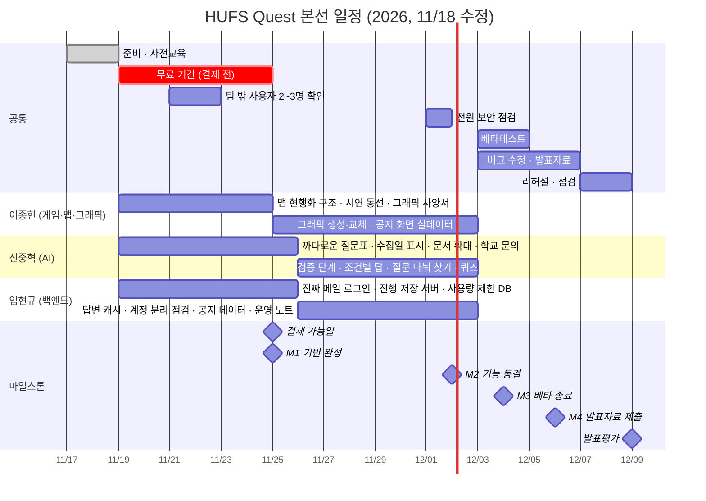

# 🗺 HUFS Quest 본선 로드맵

> **이 문서가 본선 개발 계획의 정본입니다.** 회의에서 바뀐 내용은 그날 PR로 이 파일에 반영합니다.
> 무엇을 만들고 무엇을 안 만드는지는 [PRD.md](PRD.md), 운영·보안 절차는 [OPERATIONS.md](OPERATIONS.md), 기능 연결은 [ARCHITECTURE.md](ARCHITECTURE.md)를 보세요.
> 마지막 수정: 2026-11-19 · 다음 마감: **11/25(수) 결제 · M1** → **12/2(수) 기능 동결** → **12/6(일) 23:59 발표자료 제출** → **12/9(수) 발표평가**

> ⚠️ **11/18 변경:** 예산 지급이 늦어져 유료 결제는 **11/25(수)쯤**부터 가능합니다. **11/19~11/24는 무료 플랜·무료 도구로만** 작업하고, 유료 도구가 꼭 필요한 일(그래픽 생성)은 11/25 이후로 옮겼습니다. 사전교육 피드백에 따라 건물 내부 진입·행사 실시간은 **제외**했습니다.

---

## 1. 한눈에 보기

**원칙:** 1주차(무료 기간)에 데이터·저장·보안 구조를 깔고 → 11/25 결제 후 그래픽과 화면 기능을 올리고 → 12/2 이후에는 새 기능 없이 검증과 발표 준비만 합니다.

### 무료 기간 규칙 (11/19~11/24)

- 유료 결제·유료 플랜 전환을 하지 않습니다. Vercel·Supabase는 무료 플랜, 도트 편집은 무료 도구(Piskel · LibreSprite 등), 맵은 Tiled(무료)로 합니다.
- Claude는 각자 지금 쓰는 요금제로만 씁니다. 에이전트를 여러 개 띄우지 말고 **한 번에 한 기능**씩 시켜 토큰을 아낍니다.
- CLOVA Studio는 네이버클라우드 크레딧(영업일 3~5일 뒤 지급)이 들어오기 전까지 지금 계정으로 쓰되, `npm run eval` 전체 실행은 **하루 1회 이내**로 합니다.
- 그래픽 생성 도구가 필요한 일은 **사양서·프롬프트·자리표시 그림까지만** 해 두고, 11/25에 바로 생성합니다.

---

## 2. 우선순위

새 기능을 더 넣기보다 **이미 만든 기능을 실제 데이터로, 안전하게 돌리는 것**이 우선입니다. '반드시'가 밀리면 🟢 → 🟡 순서로 뺍니다.

| 등급 | 기능 (기획서 항목) | 본선에서 보여줄 수준 | 담당 | 상태 |
| --- | --- | --- | --- | --- |
| 🔴 반드시 | 빠른 검색창 RAG 고도화 (②) | 근거 문서 확대, 까다로운 질문 묶음 추가 채점, 답변 검증 단계, **답마다 수집일·적용 기준 표시** | 신중혁 | 🟨 |
| 🔴 반드시 | 검색창 비용·남용 방어 (②, 피드백 Top 1) | IP당 1분·하루 횟수와 전체 하루 상한을 Supabase 공용 카운터로, 입력 길이·출력 토큰 상한, NCP 예산 알림 | 임현규(DB) · 신중혁(`api/ask.js` 연결) | 🟨 |
| 🔴 반드시 | 마감 임박 공지 실제 반영 (④) | 팀이 확인한 실제 공지 10건 이상 손 입력 → 팀 검수 → D-day 표시, `[예시]` 항목 삭제 (AI 추출은 보조) | 임현규(입력·저장) · 신중혁(추출·검수) · 이종헌(화면) | ⬜ |
| 🔴 반드시 | 로그인 · 진행 기록 저장 (⑥) | @hufs.ac.kr 진짜 메일 로그인, 경험치·포인트·퀴즈 기록 서버 저장, 개인정보 안내, A/B 계정 분리 확인 | 임현규(서버·메일) · 이종헌(화면, 가짜 모드 완료) | 🟨 |
| 🔴 반드시 | 맵 그래픽 개선 + 현행화 (①) | 시연 동선 건물 그래픽 교체, 건물 정보 데이터 분리, 맵 기준일·"실제와 달라요" 신고 버튼 | 이종헌 (건물 정보 내용: 임현규) | 🟨 |
| 🟡 가능하면 | 퀴즈 확장 (③) | 새 근거 문서로 문제 추가, 퀘스트로 배치, 출처 링크 점검 | 신중혁(문제) · 이종헌(배치) | ⬜ |
| 🟡 가능하면 | 복합 질문 나눠 찾기 (②) | 질문을 최대 2개 하위 질문으로 나눠 각각 검색 (Advanced RAG). 정답률이 떨어지면 반영 안 함 | 신중혁 | ⬜ |
| 🟢 여유 시 | 다국어 (⑤) | 새로 만든 화면 문구의 영어 번역만. **제3언어는 하지 않음** | 신중혁 | ⬜ |
| ❌ 제외 | 건물 내부 진입 (①) | 피드백 권고로 대회 기간 제외. 발표에서 '다음 단계'로 소개 | — | ❌ |
| ❌ 제외 | 교내 행사 실시간 반영 (⑥) | 피드백 권고로 제외(등록 권한·XSS 위험). 발표에서 '다음 단계'로 소개 | — | ❌ |

상태 표시: ⬜ 시작 전 · 🟨 진행 중 · ✅ 완료 · ❌ 제외

### 범위 밖 (본선에서 다루지 않음)

기획서(11/10)와 PRD(11/18)에서 뺀 기능입니다. **수정하거나 새 기능을 붙이지 않습니다.** 전체 목록은 [PRD.md 3장](PRD.md#3-하지-않을-것-대회-기간-1116129).

- 수강신청 추천 서비스: `public/planner/`, `src/ui/plannerOverlay.js`, `teammate/` — 본선 화면에서 버튼만 숨김(이종헌, 1주차)
- 모의 수강신청: `src/scenes/MockRegScene.js` — 진입 버튼만 숨김
- 건물 내부 진입, 행사 실시간·등록 폼, 과제 일정 등록, 제3언어, 학사정보시스템 API 실제 연동, NCP Maps 연동

---

## 3. 역할 분담

| 이름 | 주 역할 | 겸하는 역할 |
| --- | --- | --- |
| **이종헌** | PM, 게임 개발(Phaser 로직·UI), 맵·그래픽(도트 에셋), 퀘스트 시나리오, 발표 총괄 | 콘텐츠 검수, 발표 시연 |
| **신중혁** | AI 개발(문서 임베딩·RAG·답변 프롬프트·질문표) | 베타테스트 운영(공동), 법·라이선스 기록, **학교 협의 창구**, 발표 시연 |
| **임현규** | 백엔드(Supabase DB·인증·메일·진행 저장·사용량 제한·답변 캐시) | QA·배포 관리, **매일 5분 점검**, 베타테스트 운영(공동) |

> **11/18 재조정:** 피드백에서 "한 사람이 맵·그래픽과 백엔드를 함께 맡아 병목"이라는 지적을 받았습니다. 행사 실시간이 빠지면서 생긴 임현규의 2주차 여유를 **진짜 메일 로그인 설정, 사용량 제한 DB, 건물 정보 데이터 입력, 공지 데이터 입력**으로 옮겨 이종헌은 화면·그래픽에 집중합니다.

| 겸하는 역할 | 하는 일 | 담당 |
| --- | --- | --- |
| QA·배포 관리 | PR 리뷰, Merge 후 실서비스 확인, 12/2 기능 동결 이후 Merge 승인 | 임현규 |
| 매일 5분 점검 | 접속·에러·429·CLOVA 비용·Supabase 사용량 확인 ([OPERATIONS.md 3장](OPERATIONS.md#3-매일-5분-점검-담당-임현규-바쁜-날은-다른-사람이-대신)) | 임현규 |
| 콘텐츠 검수 | 퀴즈 정답·해설, 공지 날짜, 건물 정보, 영어 번역 용어 확인 (만든 사람과 다른 사람이 교차 확인) | 이종헌 |
| 베타테스트 운영 | 사전 사용자 2~3명(1주차) + 재학생 약 20명(3주차) 모집, 설문, 결과를 발표용 수치로 정리 | 임현규 · 신중혁 |
| 법·라이선스 기록 · 학교 협의 | 에셋 출처·라이선스 보관, robots.txt 준수 기록, 개인정보 안내 문구, 학교 문의 메일 | 신중혁 |
| 발표 시연 | 당일 시연 조작, 오류 시 백업 영상 전환. 발표자가 말하는 동안 다른 한 명이 조작 | 신중혁 · 이종헌 |

### 폴더별 주 담당

**주 담당은 책임자이지 독점이 아닙니다.** 일이 몰리거나 먼저 손이 비는 사람이 있으면 누구든 다른 영역의 작업을 가져가서 해도 됩니다. 허락은 필요 없고, 아래 두 가지만 지킵니다.

1. **기록 남기기**: 모든 작업은 브랜치 → push → PR → Merge로 GitHub에 남깁니다. PR 설명의 "작업 기록" 칸에 작업한 사람과, 주 담당이 다른 파일을 적습니다.
2. **충돌 피하기**: 큰 작업을 시작할 때 단톡에 "○○ 작업 시작" 한 줄을 남깁니다. 같은 파일을 동시에 고치는 일을 막기 위해서입니다.

실서비스 DB를 바꾸는 `npm run ingest`, Supabase 테이블 구조 변경, Vercel 환경 변수 변경은 누가 하든 실행한 사실을 PR에 꼭 적습니다.

| 폴더 / 파일 | 주 담당 | 내용 |
| --- | --- | --- |
| `src/scenes/`, `src/ui/`, `src/gfx/`, `src/main.js`, `index.html` | 이종헌 | 게임 장면, 화면 UI, 도트 그래픽 |
| `src/data/campus.js`, `src/data/npcs.js`, `src/quizBoxes.js` | 이종헌 | 캠퍼스 맵(건물 ID·위치), 퀴즈 상자 배치 |
| `src/data/buildingInfo.js` (새로 만듦) | 이종헌(형식) · 임현규(내용) | 건물 이름·용도·층별 사무실·출처·마지막 확인일·상태(공사 중/신규) |
| `api/ask.js`, `shared/kb.js`, `src/data/askApi.js` | 신중혁 | 빠른 검색창 서버 함수와 키워드 검색 |
| `scripts/`, `data/chunks.json` | 신중혁 | 문서 수집 · 임베딩 · 정확도 테스트 |
| 검색창 개선 1~4단계 (`scripts/`, `data/`) | 이종헌 | 복잡한 표를 조건 포함 문장 조각으로 정리·검수·ingest·eval (완료). 5단계 이후(`api/ask.js`)는 신중혁 |
| `src/data/quiz.js` | 신중혁 | O/X 퀴즈 문항 (검수: 이종헌) |
| `supabase/`, 새 `api/*` 서버 함수, `api/_lib/` | 임현규 | DB 스키마, 로그인, 진행 저장, 사용량 제한, 답변 캐시 |
| `shared/deadlines.js`, `shared/deadlineCalc.js`, `api/deadlines.js` | 임현규 (데이터 검수: 신중혁) | 마감 임박 공지 |
| `src/state.js`, `src/quizProgress.js`, `src/data/progressApi.js`, `src/data/progressMock.js`, `shared/progressRules.js` | 이종헌 · 임현규 | 게임 상태 ↔ 서버 저장 연결 (규칙은 `docs/PROGRESS_API.md`) |
| `docs/`, `CLAUDE.md`, `AGENTS.md` | 이종헌 (수정은 누구나 PR로) | PRD, 로드맵, 운영 노트, AI 작업 규칙 |
| `campus-map/` | 참고용 (배포 안 됨) | 이전 프로토타입. 건물 내부·행사는 제외됐으므로 참고할 일 거의 없음 |

---

## 4. 주차별 작업

모든 작업은 **브랜치 → PR → Preview 확인 → Merge** 순서로 진행합니다. 작업을 시작하면 GitHub Issue를 만들고, PR에 `Closes #번호`를 적어 주세요.

### 0주차 · 11/17(화)~11/18(수) 준비

- [ ] 지원금·크레딧 구글폼 제출 (11/17 17시) — 이종헌
- [ ] 개발 환경 세팅과 테스트 PR — 신중혁, 임현규
- [x] 사전교육 참석(11/18), 팀 피드백 수령 → PRD·운영 노트·로드맵 반영 (11/18)
- [ ] ~~유료 도구 결제~~ → **11/25로 연기** (예산 지급 지연)

### 1주차 · 11/19(목)~11/25(수) 기반 다지기 — 무료 기간

**공통**
- [x] 11/19 NCP 콘솔 Budgets 알림 50% · 80% · 100% 설정 — NCP 메인 계정 주인 (11/19 완료, 분기별 2026-4Q · 50만 원, [OPERATIONS.md 3장](OPERATIONS.md#3-매일-5분-점검-담당-임현규-바쁜-날은-다른-사람이-대신))
- [x] 11/19 [OPERATIONS.md 1장](OPERATIONS.md#1-계정--결제-주인-팀이-채울-것) 계정 · 결제 주인 표 채우기 — 전원 (11/19)
- [ ] 11/21~22 팀 밖 재학생(학과 동기, 팀이 섭외) 2~3명에게 지금 배포본을 보여 주고 "이중전공 기준 찾기"를 시켜 보기. 불편하다는 말과 걸린 시간을 기록 — 임현규·신중혁

**이종헌 (게임·맵·그래픽)**
- [x] 진행 저장 화면 쪽 가짜 모드 연결, 학교 이메일 6자리 코드 로그인 화면 (11/17~18)
- [x] 검색창 개선 1~4단계: 표 정리 조각(216 → 242조각), eval 43/45 유지 (11/17)
- [x] 건물 정보 분리: `src/data/buildingInfo.js` 형식 정의(건물 ID 기준). 맵 그림·`campus.js`에는 ID와 위치만 남기기 (11/19, 내용 입력은 임현규)
- [x] 화면에 "2026년 11월 기준 캠퍼스" 맵 기준일 + 공식 캠퍼스 지도 링크 + **"실제와 달라요" 신고 버튼**(외부 신고 폼 링크, 개인정보 받지 않음) (11/19, 전체 지도 화면. **신고 폼 연결 완료, 근처 건물 미리 채움**: 구글 폼은 `scripts/report-form/createReportForm.gs`로 만들고 `buildingInfo.js`의 `REPORT_FORM_URL` · `REPORT_FORM_PLACE_ENTRY`에 연결. 폼에 보내는 값은 건물 이름 하나뿐. 응답 확인 이종헌)
- [x] 로그인 화면에 개인정보 안내 4줄(문구: 신중혁, [OPERATIONS.md 8장](OPERATIONS.md#8-개인정보)) (11/19, 1단계에 4줄 + 동의 체크박스, 체크해야 "인증 코드 받기" 켜짐. 문구 초안은 이종헌 작성 → 신중혁 확인 필요)
- [x] 범위 밖 버튼(수강신청 추천, 모의 수강신청) 숨김 (11/19, `src/data/features.js`의 `SHOW_OUT_OF_SCOPE = false`, true로 바꾸면 다시 보임)
- [ ] 시연 동선 확정(건물 3~4곳) + 시연 시나리오 초안('한 사람' 기준)
- [ ] 그래픽 사양서: 동선 건물별 타일 크기·팔레트·참고 사진·생성 프롬프트, 무료 도구로 자리표시 그림 → 11/25 바로 생성 가능하게

**신중혁 (AI)**
- [ ] 11/20까지 학교 문의 메일(공개 학사 페이지를 검색창 근거로 쓰는 것 확인 + 학사정보시스템 Open API 여부) — [OPERATIONS.md 7장](OPERATIONS.md#7-학교-협의-기록)
- [ ] `scripts/eval.mjs`에 **까다로운 질문 묶음** 추가: 규칙 무시 요구 3, 태그 삽입 요구 2, 복합 질문 3, 한영 섞인 질문 2, 이름 비슷한 제도 2 → 바꾸기 전 기준선 측정 (지금 50문항: 정답 43/45, 범위밖 5/5)
- [ ] 조각마다 **수집일 · 적용 기준(몇 학기·몇 학번부터)** 저장(`scripts/collect.mjs`·`ingest.mjs`), 검색창 출처에 "○○ 수집 기준" 표시
- [ ] `scripts/urls.txt`에 학칙 전문·학사일정·수강편람 추가 → `collect` → 검수 → `ingest` → eval (robots.txt 허용 범위만, 떨어지면 반영 안 함)
- [ ] `api/ask.js` 출력 토큰 상한을 실제 답 길이에 맞게 줄이기(지금 1000), 임현규의 공용 카운터 연결
  - 11/18: 1000으로 올린 뒤 eval `20261118-2306` 정답 43/45(변화 없음), 한국어 답 중앙값 86자 · 최대 522자, 잘린 답 없음. CLOVA 문서에 글자↔토큰 환산이 없어 **Vercel 로그에 `completionTokens` · `finishReason` · 답 글자 수를 남기도록 함** → eval 한 번 더 돌려 최댓값을 보고 상한 결정
  - 11/19: 공용 카운터 연결 코드 완료(`api/_lib/usageLimit.js`, 분당 10 · 하루 50 · 전체 500, Supabase 실패 시 메모리 제한으로 대체, eval 토큰 `ASK_EVAL_TOKEN`). **Preview 확인 · 토큰 상한 결정은 아직**

**임현규 (백엔드)**
- [x] 진짜 메일 로그인: 무료 외부 SMTP 연결, 메일 발송 한도를 베타 20명에 맞게 조정, 학교 메일만 허용하는 Auth Hook ([AUTH_SETUP.md](AUTH_SETUP.md) 4·6장) (11/19)
- [x] 진행 저장·불러오기 서버 함수, 퀴즈 중복 보상과 하루 상한을 서버에서 검증 (11/19, Preview 확인 전)
- [x] `supabase/003_usage_limits.sql`: 검색창 사용량 카운터(IP 해시 · 1분 · 하루 · 전체 하루 상한), RLS 켜기, `anon` 실행 권한 회수
  - 11/18: SQL 작성 · 대시보드 실행 완료(`ask_hit` 함수, 분당 · 전체 초과 · 권한 · RLS 확인, 시험 행 정리). 11/19 `api/ask.js` 연결 코드 완료(위 신중혁 항목)
- [ ] 건물 정보 내용 입력(이름·용도·층별 학과 사무실·출처·확인일). 공식 캠퍼스 안내 페이지 기준
- [ ] 실제 공지 10건 손 입력 시작(`shared/deadlines.js`, 게시판 자동 수집 금지)

### 11/25(수) 결제일

결제 순서와 금액은 [5. 예산](#5-예산과-결제-1125-이후). 결제 직후 그래픽 생성 시작.

### 2주차 · 11/26(목)~12/2(수) 핵심 기능 완성

**이종헌 (게임·맵·그래픽)**
- [ ] 시연 동선 건물 그래픽 생성·교체(`src/gfx/textures.js`). 동선 밖 건물은 지금 그림 유지
- [ ] 마감 임박 공지 화면(`src/ui/deadlineOverlay.js`)을 실제 데이터와 연결
- [ ] 퀘스트 목적지·퀴즈 배치를 건물 ID로 연결(이미 `quest.destination`은 ID), 새 퀴즈 배치
- [ ] 진행 저장 `VITE_PROGRESS_MODE=real` 전환 후 Preview에서 임현규와 확인

**신중혁 (AI)**
- [ ] 답변 문장을 근거 문서와 한 번 더 대조하는 검증 단계 추가(`api/ask.js`)
- [ ] 검색창 개선 5단계: 캠퍼스·학번·단과대학 조건이 없는 질문은 조건별로 나눠 답하는 지시문, eval '2025학번 졸업학점' 문항 분리
- [ ] (가능하면) 복합 질문을 최대 2개 하위 질문으로 나눠 각각 검색. 호출이 늘어나므로 하위 질문 수 상한 고정
- [ ] 공지 추출(HyperCLOVA X, 팀원이 원문을 붙여 넣는 방식) → 팀 검수 → 반영, `[예시]` 삭제
- [ ] 새 문서 기반 O/X 퀴즈 문항 추가(정답·해설·원문 링크), 퀴즈·NPC 대사 출처 링크 점검

**임현규 (백엔드)**
- [ ] 같은 질문 답변 캐시(Supabase, ingest하면 비움) — 발표장 동시 질문 대비
- [ ] A/B 계정으로 남의 기록이 안 보이는지 확인, 결과를 PR에 기록
- [ ] 공지 데이터 10건 이상 완료, 신중혁 교차 검수
- [ ] Supabase Pro 전환 여부 결정(12/2), 베타 통계 내보내기 방법(이메일 없이 숫자만)

**12/1(월) 전원 보안 점검** — [OPERATIONS.md 4장](OPERATIONS.md#4-배포-전-5분-점검) 체크리스트를 실서비스에서 전부 실행

### 3주차 · 12/3(목)~12/6(일) 검증과 발표 준비 — 새 기능 금지

- [ ] 재학생 베타테스트 약 20명, 사용성 설문 (12/3~12/4) — 임현규·신중혁 운영, 전원 지원
- [ ] 베타에서 나온 버그 수정 — 이종헌(게임 화면), 임현규(서버), 신중혁(검색창)
- [ ] `eval` 최종 정답률(기본 묶음 + 까다로운 묶음) 측정, 발표용 수치 정리 — 신중혁
- [ ] 에셋 라이선스·데이터 수집 기록·학교 협의 결과 정리(질의응답 대비) — 신중혁
- [ ] 발표 PPT(10분): 문제 정의 한 문장, 하지 않을 것, 정답률, 비용 방어, 개인정보, 운영 계획 포함 — 이종헌 총괄
- [ ] 시연 시나리오, 시연 영상 백업 녹화, 12/6 23:59까지 PPT 메일 제출 — 이종헌

### 발표 직전 · 12/7(월)~12/9(수)

- [ ] 리허설 2회, 10분 시간 맞추기 — 전원
- [ ] 시연 상태 점검 — 신중혁(CLOVA·검색창), 임현규(Supabase·시연용 계정 2개·데이터)
- [ ] 12/9 발표평가(09:30~12:30, 미네르바컴플렉스 국제회의실)와 시상식(14:30~) — 전원

### 대회 후 · 12/10~12/31

- [ ] 개인정보 일괄 삭제(12/31까지), 키 폐기 또는 계속 운영 결정 — [OPERATIONS.md 9장](OPERATIONS.md#9-대회-후-이관-체크리스트-1210-이후)

---

## 5. 예산과 결제 (11/25 이후)

현금 약 70만 원, **예비비 20만 원 유지**가 기준입니다. 네이버클라우드 크레딧 50만 원은 NCP(CLOVA Studio 등)에서만 쓰고 현금과 섞지 않습니다.

| 순서 | 항목 | 원래 계획 | 11/18 제안 |
| --- | --- | --- | --- |
| 1 | Claude Max 1 + Pro 2 | 약 22.4만 | 그대로. 11/25 결제 |
| 2 | 그래픽 생성 도구 | Retro Diffusion 7.2만 + PixelLab 3.8만 | 사양서로 **하나 먼저 시험**하고 부족할 때만 둘째 결제 → 최대 약 7만 절약 |
| 3 | Aseprite | 약 3.2만 | 무료 도구(LibreSprite·Piskel)로 1주차를 해 보고 불편할 때만 결제 |
| 4 | 상업용 타일 에셋팩 | 약 3만 | 라이선스(웹 게임·공개 저장소 사용 가능) 확인 후 |
| 5 | Supabase Pro | 약 4만 | **12/2에 결정.** 매일 쓰는 동안은 무료 플랜 일시정지(비활동 기준) 위험이 낮음 |
| 6 | 베타테스트 사례 | 약 6만 | 그대로 |
| — | 예비비 | 약 20만 | 절약분은 예비비에 더함 |

---

## 6. 마일스톤과 통과 기준

마일스톤 날 밤에 15분 팀 점검을 하고, 기준을 못 맞춘 항목은 바로 범위를 줄입니다.

| 날짜 | 마일스톤 | 통과 기준 |
| --- | --- | --- |
| 11/25(수) | **M1 기반 완성** | 진짜 학교 메일로 로그인 후 경험치가 서버에 저장 · 검색창 공용 사용량 제한 실서비스 적용 · NCP 예산 알림 설정 · 까다로운 질문 묶음 포함 기준선 측정 · 건물 정보 데이터 분리 · 팀 밖 사용자 2~3명 확인 완료 · 그래픽 사양서 완성 |
| 12/2(수) | **M2 기능 동결** | 🔴 반드시 5개가 실서비스(hufs-quest.vercel.app)에서 동작 · 12/1 보안 점검 통과. 이후로는 버그 수정만 Merge |
| 12/4(금) | **M3 베타 종료** | 재학생 20명 내외 사용 기록과 설문 결과 확보 |
| 12/6(일) 23:59 | **M4 발표자료 제출** | PPT 메일 제출, 시연 영상 백업 확보 |
| 12/9(수) | **발표평가** | 10분 발표와 라이브 시연 |

---

## 7. 예상 위험과 대응

| 위험 | 대응 |
| --- | --- |
| 결제가 11/25로 밀려 그래픽 작업이 1주로 압축 | 1주차에 사양서·프롬프트·자리표시 그림까지 끝내고, 그래픽은 시연 동선 3~4곳만. 12/1까지 못 끝낸 건물은 지금 그림 유지 |
| 검색창을 누구나 마구 호출해 토큰 폭주 (하루 약 11만 토큰 사용 중) | 공용 카운터로 IP당·전체 하루 상한, 입력·출력 길이 상한, 같은 질문 캐시, NCP 예산 알림, 매일 비용 확인 |
| 지금 요청 제한은 서버 인스턴스마다 따로 세서 사실상 약함 | 1주차에 Supabase 공용 카운터로 교체 |
| Supabase 기본 메일 서버 한도로 베타 20명이 로그인 못 함 | 1주차에 무료 외부 SMTP 연결, 한도 조정 후 팀원 3명 + 테스트 계정으로 시험 |
| 문서를 늘렸더니 기존 정답이 틀려짐 | 재임베딩·프롬프트 변경 전후로 같은 eval을 돌려 정답률이 떨어지면 반영하지 않음 |
| "규칙 무시하고 답해" 같은 요구에 지시문이 뚫림 | 까다로운 질문 묶음으로 매번 채점. 지시문만 믿지 않고 서버 코드(근거 없는 숫자 거르기, 출처 번호 확인)로 막음 |
| 학교가 공개 페이지의 검색창 사용을 불허 | 해당 페이지 제외 후 eval 재측정, 발표에서 협의 과정을 그대로 설명 |
| 발표장 동시 질문으로 CLOVA 요청 제한(429) 초과 | 답변 캐시, 재시도, 시연 영상 백업 |
| `src/state.js` 등 공동 파일 동시 수정으로 충돌 | 공동 파일은 수정 전 단톡 공유, 브랜치는 하루 안에 Merge |
| AI가 공지 날짜를 잘못 추출 | 팀 검수 후에만 표시, 항상 원문 링크 함께 표시 |
| 키 노출 | [OPERATIONS.md 2장](OPERATIONS.md#2-비밀-키-규칙) 순서대로 즉시 폐기·재발급 |

---

## 8. 팀이 정할 것

- [ ] 팀원별 기말고사·과제 일정을 모아 바쁜 주의 작업량 조정
- [ ] 시연 동선에 넣을 건물 3~4곳
- [x] ~~OPERATIONS.md 1장 계정·결제 주인 표~~ → Vercel·Supabase·NCP 메인·SMTP 모두 이종헌 (11/19)
- [ ] 그래픽 생성 도구를 하나만 쓸지 둘 다 쓸지 (11/25 시험 후)
- [ ] Supabase Pro 전환 여부 (12/2)
- [x] ~~팀 밖 사전 사용자 2~3명 누구에게 보여 줄지~~ → 학과 동기로 팀이 섭외 (11/19)
- [ ] 실제 공지를 어느 부서 게시판에서 고를지
- [x] ~~범위 밖 기능을 본선 화면에서 숨길지~~ → 숨김 (11/18)
- [x] ~~행사 등록 주체에게 시범 등록을 부탁할지~~ → 행사 실시간 제외로 해당 없음 (11/18)

---

## 9. 이 문서를 고치는 방법

1. 회의에서 바뀐 내용이 있으면 그날 `docs/roadmap-YYMMDD` 브랜치를 만들어 이 파일을 고칩니다.
2. 아래 변경 기록에 한 줄 추가하고 PR을 올립니다.
3. 진행 상태(⬜🟨✅❌)와 체크박스는 기능 PR을 Merge할 때 같이 고쳐도 됩니다.

### 변경 기록

| 날짜 | 변경 내용 | 작성 |
| --- | --- | --- |
| 2026-11-17 | 본선 로드맵 첫 작성, 역할 재분담(게임·맵·그래픽 이종헌 / AI 신중혁 / 백엔드 임현규) | 이종헌 |
| 2026-11-17 | 폴더별 담당에 검색창 개선 1~4단계(이종헌) · 5~6단계(신중혁) 분담 추가 | 이종헌 |
| 2026-11-17 | 검색창 개선 1~4단계 완료(표 정리 조각, 242조각, eval 43/45 유지), RAG 고도화 상태 🟨, 5단계 할 일 추가 | 이종헌 |
| 2026-11-17 | 로그인 · 진행 기록 저장 🟨 진행 중: 화면 쪽 가짜 모드 연결 완료, 서버 연결과 로그인 화면 남음 | 이종헌 |
| 2026-11-17 | 협업 방식 변경: 담당은 책임자일 뿐 누구나 어떤 작업이든 가능, 대신 모든 작업은 PR로 기록 | 이종헌 |
| 2026-11-18 | 학교 이메일 6자리 코드 로그인 화면 완료(가짜 모드), 남은 일에 Supabase 메일 설정 후 진짜 메일 시험 추가 | 이종헌 |
| 2026-11-18 | 로그인 아이디를 학번 9자리에서 학교 메일 아이디(영문 대 · 소문자와 숫자, 최대 64자)로 고침 | 이종헌 |
| 2026-11-18 | 사전교육·팀 피드백 반영: 결제 11/25 연기에 맞춘 무료 기간 규칙, 건물 내부·행사 실시간 제외, 검색창 비용 방어·맵 현행화 🔴 추가, 임현규에게 메일 로그인·사용량 제한·건물 정보·공지 데이터 이관, 예산 제안, PRD·OPERATIONS 문서 연결 | 이종헌 |
| 2026-11-18 | 검색창 출력 토큰 상한 정하기 1단계: eval 재측정(43/45 유지), `api/ask.js` 로그에 실제 토큰 수 · 멈춘 이유 · 답 글자 수 추가 | 이종헌 |
| 2026-11-18 | 검색창 공용 사용량 카운터 SQL(`supabase/003_usage_limits.sql`) 작성 · 대시보드 실행, `api/ask.js` 연결 전 | 이종헌 |
| 2026-11-19 | 검색창 공용 사용량 제한 연결(`api/_lib/usageLimit.js`): 003 항목 완료 처리, Preview 확인 남음 | 이종헌 |
| 2026-11-19 | 범위 밖 버튼(수강신청 추천, 모의 수강신청) 숨김 완료 | 이종헌 |
| 2026-11-19 | 로그인 화면 개인정보 안내 4줄 + 동의 체크박스 완료 | 이종헌 |
| 2026-11-19 | 건물 정보 분리(`buildingInfo.js`), 전체 지도에 맵 기준일·공식 지도·신고 버튼 → 맵 현행화 🟨. 계정 주인 표(전원 이종헌), 사전 사용자는 학과 동기 | 이종헌 |
| 2026-11-19 | "실제와 달라요" 신고 폼(구글 폼) 연결 완료, 근처 건물 이름 미리 채움 | 이종헌 |
